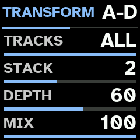

<p align="center">
  <picture>
    <source media="(prefers-color-scheme: dark)" srcset="docs/assets/logo-dark.svg">
    
  </picture>
</p>

# Quasar

Firmware for M-VAVE FM-1, for experimental IDM, after SOMA Pulsar-23.

Quasar models Pulsar-23 as whole instrument -- its BD, BASS, SD and HHT circuits, its SHAOS shift register,
LFO, clock and dividers, FX processor and distortion -- with audio engine written from scratch for FM-1's chip,
aimed at experimental IDM. 6 tracks, 16 engine profiles, 147 sound families, macros and internal routes, WRECK,
TRANSFORM, phrase generator with polymeters, 10 BREAK ways and PERFORMANCE mode.

Website, browser installer and manual: <https://nzimas.github.io/quasar/>.

> [!WARNING]
> Quasar is unofficial. It is not made, endorsed or supported by M-VAVE or SOMA Laboratory, and installing it may
> void any warranty that applies to your FM-1. See [disclaimer](#disclaimer).

## Install

From browser: open [installer](https://nzimas.github.io/quasar/install.html) in desktop Chrome, Edge or
Opera, connect FM-1 with USB data cable and press Install. After installing, switch FM-1 off and on once.

From command line (macOS or Linux): `./setup.sh` once, then `./install.sh` (builds, then installs) or
`./install.sh FILE.fwsc` (installs package). `./install.sh --info` says what connected FM-1 runs.

# Manual

## Playing it

| Control | What it does |
| --- | --- |
| **6 top buttons** | choose track **1–6** (lit: chosen; glowing dimly: sounding). From any page, back to track. In [MUTE mode](#mute-mode): mute and solo. |
| **PRESETS** knob | chosen track's [engine profile](#engine-profiles): **BD**, **HAMMER**, **SKIN**, **SD**, **WALL**, **WIRE**, **TONE**, **HHT**, **STATIC**, **METAL**, **SHAKE**, **GRIND**, **BASS**, **FM**, **PRC**, **PLUCK**. |
| **SHIFT + PRESETS** | new sound of family before or after, within profile. |
| **HOME** | new sound for chosen track, from another family of its profile ([Sounds](#sounds)). |
| **SHIFT + HOME** | new sound of same family. |
| **HOME held** (0.8 s) | save session, as SAVE held. |
| **OCT− / OCT+** | chosen track's octave, −3 to +3. In step view: track's [transposition](#transposition). |
| **SHIFT + OCT− / OCT+** | every track's transposition. |
| white keys | play chosen track in scale; keys that play root glow dimly. In step view: track's 16 steps. On PATTERNS and SESSIONS grids: 16 slots. |
| black key 1 | [CHORD mode](#chord-mode) on or off. **SHIFT +**: next chord form. |
| black key 2 | [MUTE mode](#mute-mode) on or off. |
| black key 3 | **held**: [BREAK](#break) on chosen track. **SHIFT +**: on every track. |
| black key 4 | [MIDI LEARN](#midi-learn) on or off. |
| black key 5 | chosen track's [arpeggiator](#arpeggiator) on or off. **Held** (0.8 s): its page. |
| black key 6 | **SHIFT +** it **held**: [TRANSFORM](#transform) on. **Held** alone (0.8 s): TRANSFORM page. |
| black key 7 | [PERFORMANCE](#performance) on or off. In step view: **SHIFT +** it. |
| black key 9 (3rd from right) | **STEP**: [step view](#step-view). **SHIFT +**: empty chosen track's steps. |
| black key 10 | **EDIT**: [sound pages](#sound-pages-edit). |
| black key 11 (last) | **SHIFT**. |
| **SELECT** knob | chosen track's level. On SCALE page: root. |
| **ALGORITHM** knob | chosen track's pan. On SCALE page: scale. |
| **KNOB 1–4** | chosen track's [macros](#macros) 1 to 4. On page: its rows A–D. |
| **SHIFT + KNOB 1–4** | chosen track's DRIVE, FX send, ATTACK and macro 8. |
| **PLAY** | start or stop [sequencer](#sequencer). **Held** (0.8 s): [TEMPO](#tempo) page. |
| **SHIFT + PLAY** | metronome on or off. |
| **REC** | [record](#recording) keys into chosen track's steps. |
| **SHIFT + REC** | [looper](#looper): arm loop. **Held**: track's loops on white keys. |
| **ARP** | SCALE page ([Scales](#scales)); ARP again leaves it. |
| **SHIFT + ARP** | new scale and root, drawn at random; SCALE page shows them for 1.5 s. |
| **SEQ** | [panel pages](#effects-seq), then chosen track's DUCK and [automation LFOs](#automation-lfos), in turn. |
| **SHIFT + SEQ** | chosen track's automation LFOs drawn anew. |
| **SAVE** | [PATTERNS](#patterns) grid; SAVE again leaves it. |
| **SAVE held** (0.8 s) | save session. On PATTERNS grid: save pattern playing into slot under cursor, which then plays. |
| **SHIFT + SAVE** | [SESSIONS](#sessions) grid; SHIFT + SAVE again leaves it. |
| **SHIFT + SAVE held** (0.8 s) | [GLOBAL SETUP](#global-setup): START and MIDI. |
| **MASTER** | output level. |
| MIDI in (USB and TRS) | notes and CCs for each track ([MIDI](#midi)). |

While macro knob turns, screen shows its value as large dial for 1 s.


## Tracks and sounds

Quasar models SOMA Pulsar-23 drum synthesizer with engine written from scratch. It follows instrument's
published behaviour; no circuit values were available, and it has not been compared by ear with real Pulsar-23.
It is aimed at IDM 1st, rhythmic noise 2nd.

6 tracks, each with its own engine profile, sound, octave, level, pan, steps and loops. There are no subtracks. Each
track is 1 circuit and sounds 1 note at a time: new note strikes it again at new pitch. Every sound is
percussive: it falls once its attack peaks, whether key is held or not.

There is no TUNE control. Every circuit takes its pitch from note played, drums too, so drums follow scale.
BD sounds 2 octaves below note, SD's pitched noise 4 above, HHT's noise clock 6 above, BASS at note;
each recipe sets offset from it.

Velocity sets how hard circuit is struck. Keys always play at full velocity.

FM-1's 2nd processor core renders about half the sounding tracks. If it ever faults, 1st core carries
on alone until FM-1 is switched off, and screen says **1 CORE**.

Start (and new session): track 1 HAMMER, 2 GRIND, 3 WALL, 4 HHT, 5 SKIN, 6 STATIC, track 1: octave down.

### Engine profiles

**PRESETS** chooses chosen track's profile: circuit and 1 of its modes. BD, SD, HHT and BASS are
Pulsar-23's 4 voices; others are modes written for Quasar that go past instrument.

| Profile | Circuit | What it is |
| --- | --- | --- |
| **BD** | BD | Pulsar's kick: triangle core with pitch sweep at each strike, shaped from triangle to sine to square. Kicks, toms, zaps |
| **HAMMER** | BD | BD core folded over 1 to 9 times, low noise rumble that outlasts strike, click and hard clip: industrial impact, gabber, doom |
| **SKIN** | BD | struck membrane, its fundamental and 2nd mode, with stick click: war toms, tabla, surdo |
| **SD** | SD | Pulsar's snare: pink noise and pitched noise, clap, resonant band-pass |
| **WALL** | SD | power noise: sample-rate crush, dropped bits, rhythmic chop, screaming band-pass and hard clip. No clap |
| **WIRE** | SD | snare noise through comb 2 octaves above note: buzz, rattle, tin |
| **TONE** | SD | 2 struck body modes against filtered noise: 808-style tone snares |
| **HHT** | HHT | Pulsar's hat: noise resampled at clock that follows note, spectrum warp, resonant high-pass |
| **STATIC** | HHT | electrical crackle: impulses and short arcs ringing in high-pass |
| **METAL** | HHT | 6 square oscillators at 808's ratios, summed or ring-modulated: cymbals, scrap |
| **SHAKE** | HHT | noise in grains a few milliseconds long |
| **GRIND** | BASS | oscillator pushed by its own overdriven filter, ring-modulated by noise: screams, howl, drills |
| **BASS** | BASS | Pulsar's bass: feedback oscillator from sine to saw to square, warp shaper, resonant low-pass, glide |
| **FM** | BASS | 2-operator ping: gongs, clang, broken bells |
| **PRC** | BASS | 3 resonators struck by impulse and noise, harmonic or detuned cluster |
| **PLUCK** | BASS | struck string: sitar buzz, piano wire |

Track keeps 1 sound for each of 4 circuits (BD, SD, HHT, BASS), modes included. Turning PRESETS onto profile
whose circuit's sound is in that mode finds it as it was; onto another mode of circuit, it draws new sound of
that profile, in place of circuit's sound. So turning from SKIN to SD and back finds both; turning from HAMMER
to SKIN replaces HAMMER sound. MODE row of [circuit page](#sound-pages-edit) changes mode in place,
sound's knobs kept.

### Sounds

**HOME** draws new sound for chosen track from another family of its profile: recipe such as BURNT 909,
GABBER, WAR TOM, NOISE WALL, SHARD HAT, GEIGER, SCREAMER or BROKEN BELL. **SHIFT + HOME** draws another from same
family; **SHIFT + PRESETS** moves to family before or after, within profile. Screen shows profile
and family. There are 147 families, all percussive and abrasive: no drones, no long decays.

| Circuit | Profiles (families) |
| --- | --- |
| BD | BD (19), HAMMER (11), SKIN (11) |
| SD | SD (12), WALL (10), WIRE (7), TONE (5) |
| HHT | HHT (13), STATIC (7), METAL (8), SHAKE (5) |
| BASS | GRIND (11), BASS (9), FM (7), PRC (6), PLUCK (6) |

Each family is circuit setting, envelope, drive and FX send, and up to 4 [routes](#routes). Each drawing
moves every knob by family's spread, picks each route's source and depth, varies drive and send, adds
further route half the time, and [wrecks](#wreck) about half the sounds. So SHIFT + HOME seldom gives same sound
twice. Each family's VOL is set to level its hits against others, hats about 6 dB under. SHAOS and clock
dividers step drive, filters and level in recipes, never pitch.

## Sound pages (EDIT)

Black key 10 (**EDIT**) shows sound's 6 pages: circuit's own (titled with profile), ENV, WRECK, MACRO,
ROUTE 1 and ROUTE 3. **KNOB 1–4** set rows A to D; **PRESETS** turned right shows E to H, left goes back. **OCT− /
OCT+** move between pages. EDIT again leaves. Values read 0 to 100.

### Circuit page

Circuit's knobs, named as its mode uses them; last row is MODE.

| Profile | A | B | C | D | E | F | G |
| --- | --- | --- | --- | --- | --- | --- | --- |
| BD | AMT | PITCH | SHAPE | STAB | MODE | | |
| HAMMER | AMT | PITCH | FOLD | RUMBLE | MODE | | |
| SKIN | AMT | PITCH | HEAD | STICK | MODE | | |
| SD | AMT | CLAP | MIX | BPF FR | BPF Q | MODE | |
| TONE | AMT | CLAP | NOISE | BPF FR | BPF Q | MODE | |
| WIRE | AMT | CLAP | MIX | BPF FR | BUZZ | MODE | |
| WALL | CRUSH | CHOP | BITS | BPF FR | BPF Q | MODE | |
| HHT | WARP | HPF FR | HPF Q | MODE | | | |
| METAL | RING | HPF FR | HPF Q | MODE | | | |
| SHAKE, STATIC | DENSITY | HPF FR | HPF Q | MODE | | | |
| BASS, PRC | SHAPE | WARP | AMT | LPF FR | LPF Q | GLIDE | MODE |
| PLUCK | BRIGHT | SUSTAIN | AMT | LPF FR | LPF Q | GLIDE | MODE |
| FM | RATIO | INDEX | AMT | LPF FR | LPF Q | GLIDE | MODE |
| GRIND | FDBK | RING | AMT | LPF FR | LPF Q | GLIDE | MODE |

- **AMT** sets how far route into circuit's modulation input moves it (BD: MOD, pitch; SD: TUNE; BASS: PM).
  With no route there, it does nothing.
- **PITCH** (BD): depth and decay of pitch sweep at each strike. **STAB**: core restarts at each strike.
- **CLAP** (SD, TONE, WIRE): 1 to 4 bursts. It sounds only on hits of velocity 113 or more (step's VEL 89 or more);
  keys always clap.
- **MODE**: BD: TRI, SKIN, HAMMER; SD: NOISE, TONE, WIRE, WALL; HHT: NOISE, METAL, SHAKE, STATIC; BASS: DCO, PRC,
  PLUCK, FM, GRIND. Changing it changes profile.

### ENV

ATT (attack, from 0.3 ms to about 5 s), REL (release), VOL (sound's level; each family's own at first), FX (its
send to [FX processor](#effects-seq)) and, on E, DRIVE (voice's overdrive, also on SHIFT + KNOB 1 and MACRO
page). REL stops growing at 57: every sound is short.

### WRECK


Stage after sound's overdrive: **FOLD** (triangle wavefolder), **RING** (ring modulator with its own sine),
**RING FRQ** (its frequency, 20 Hz to 5 kHz, whatever note), **CRUSH** (sample-rate reduction), and on E,
**BITS** (up to 12 bits dropped). All at 0 bypass it. About half of all new sounds come with 1 or 2 of them.
Phrases lock them step by step, and BREAK's WRECK layer throws them onto single hits.

### Macros

KNOB 1–4 on track's view turn sound's macros 1 to 4, and SHIFT + KNOB 1–4 its macros 5 to 8. MACRO page
shows all 8. Names depend on circuit:

| Circuit | KNOB 1 | KNOB 2 | KNOB 3 | KNOB 4 | SHIFT + 1 | SHIFT + 2 | SHIFT + 3 | SHIFT + 4 |
| --- | --- | --- | --- | --- | --- | --- | --- | --- |
| BD (BD, HAMMER, SKIN) | PUNCH | SHAPE | CHAOS | DECAY | DRIVE | FX | ATTACK | BEND |
| SD (SD, WALL, WIRE, TONE) | TONE | SNAP | CHAOS | DECAY | DRIVE | FX | ATTACK | RING |
| HHT (HHT, STATIC, METAL, SHAKE) | TONE | GRIT | CHAOS | DECAY | DRIVE | FX | ATTACK | RING |
| BASS (GRIND, BASS, FM, PRC, PLUCK) | CUTOFF | TIMBRE | MOTION | DECAY | DRIVE | FX | ATTACK | RESO |

Macros 1–4 and 8 move sound about its recipe: 50 is recipe as drawn (white tick on screen's bars),
lower takes away, higher adds. Each moves up to 4 of circuit's knobs at once:

| Circuit | Macro | What it moves |
| --- | --- | --- |
| BD | PUNCH | pitch sweep up, release a little shorter, SHAPE a little |
| | SHAPE | SHAPE (triangle towards square; FOLD on HAMMER, HEAD on SKIN) |
| | CHAOS | AMT |
| | DECAY | release, and a little more pitch sweep |
| | BEND | AMT, less far |
| SD | TONE | band-pass frequency, pitch, MIX |
| | SNAP | CLAP up, MIX down, band-pass Q up |
| | CHAOS | AMT |
| | DECAY | release |
| | RING | band-pass Q |
| HHT | TONE | high-pass frequency, pitch |
| | GRIT | WARP up, pitch down, Q a little |
| | CHAOS | nothing directly: only routes set to M3 |
| | DECAY | release |
| | RING | high-pass Q up, frequency a little down |
| BASS | CUTOFF | low-pass frequency, WARP a little |
| | TIMBRE | SHAPE, WARP, Q a little |
| | MOTION | AMT |
| | DECAY | release, cutoff a little down |
| | RESO | low-pass Q, cutoff a little down |

Knobs moved keep their meaning in mode: SNAP on WALL moves CHOP and BITS. [Route](#routes) set to M1–M4 or
M8 is scaled by that macro too (0 off, 50 as set, 100 about 2×), so CHAOS and MOTION open or close sound's
modulation.

Macros 5–7 are sound's own DRIVE, FX send and ATTACK. **DRIVE** is voice's overdrive: pre-emphasis,
asymmetric clipper whose bias sags with level, and de-emphasis that darkens as it rises; level stays about
same, so it thickens rather than gets louder. At 0 it is bypassed.

### Routes

ROUTE 1 shows routes 1 (A–D) and 2 (E–H); ROUTE 3 routes 3 and 4. Each route is patch cable inside sound:

| Row | What it sets |
| --- | --- |
| SRC | source: -- (none), pin of any track (1 OUT, 2 ENV ...), OWN OUT and OWN ENV (track sound is on), NOISE, clock and its dividers (CLK, DIV 16 to DIV .25), SHAOS's outputs (SH 1B, SH 2B, SH 1B SH, SH 3B SH), LFO (LFO SQR, LFO TRI), FX outputs, and panel's other pins |
| DST | where it goes. BD: EXT, MOD, WTF?, OMG!, DRIVE, VCA. SD: EXT, TUNE, BPF, DRIVE, VCA. HHT: EXT, TUNE, HPF, DRIVE, VCA. BASS: EXT, CV IN, SHAPE, WARP, PM, LPF, DRIVE, VCA |
| DEPTH | −127 to +127; on VCA, negative ducks |
| MACRO | -, or M1 to M8: macro that scales it (M5 to M7 do not) |

EXT feeds source into circuit as audio; DRIVE and VCA push sound's drive and level. Route from another
track's OUT gives cross-modulation and feedback between tracks. Panel's utility pins (VCAs, switches, attenuators,
pulse converters, diode, capacitors, TOUCH and MIDI CV) need cables on Pulsar-23; Quasar has none, so they give
nothing useful. Route arrives about 0.73 ms late; those other than EXT are followed every 4th sample.

## Keys and scales

White keys play chosen track in scale: 1st key is root, each key next degree. Keys
that play root glow dimly. USB and TRS MIDI notes play chosen track as keys do ([MIDI](#midi)).

### Scales

**ARP** opens SCALE page: **SELECT** sets root, **ALGORITHM** scale. ARP again, or track button, leaves
it. **SHIFT + ARP** draws scale and root at random and shows them for 1.5 s over any page. Scale and root
belong to session. New session draws them at random.

Scales: CHROMATIC (black key 8 plays too), MAJOR, MINOR NATURAL, MINOR HARMONIC, DORIAN, PHRYGIAN, MINOR PENTA,
MAJOR PENTA, WHOLE TONE, JAPANESE IN, MINOR MELODIC, ENIGMATIC, LYDIAN, MIXOLYDIAN, LOCRIAN, BLUES, HUNGARIAN MINOR,
DOUBLE HARMONIC, PHRYGIAN DOMINANT, JAPANESE HIRAJOSHI, JAPANESE IWATO, PELOG, OCTATONIC, PROMETHEUS.

### Transposition

In step view, **OCT− / OCT+** move chosen track's steps and loops 1 step of scale down or up (in
CHROMATIC, semitone). **SHIFT + OCT− / OCT+**, in track's view or step view, move every track's. Notes stay
in scale. Transposition shows at top right, beside octave (T+2, T−1), up to 24 steps each way. It is
part of pattern: saved with it, and copied with it. It moves only loops of pattern playing; loop being
recorded is left as it is. Keys' octave does not change.

### CHORD mode

Black key 1 turns CHORD mode on or off for chosen track (lit while on). Each white key then gives chord from its
note, in scale. **SHIFT +** black key 1 chooses next form: TRIAD, INV 1, INV 2, SUS2, SUS4, OPEN, FOURTHS.
Form shows at top left. Steps, recording and looper take chords. Tracks on BD circuit (BD,
HAMMER, SKIN) take no chords: NO CHORDS shows.

Track sounds 1 note at a time, so chord is heard as its last note only. CHORD mode matters most as way to
write chords into steps and loops, and to feed [arpeggiator](#arpeggiator).

### Arpeggiator

Black key 5 turns chosen track's arpeggiator on or off (lit while on; ARP shows at top left). Keys held,
and MIDI notes for track, then play 1 at a time on tempo's grid: with sequencer's 16ths while it plays,
on their own at tempo while it is stopped. With CHORD mode on, each key gives it chord's notes.

**Hold black key 5** (0.8 s) to open or close ARP page (KNOB 1–4 rows A to D; PRESETS right, E to H):

| Row | What it sets |
| --- | --- |
| MODE | UP, DOWN, UP DOWN, DOWN UP, ORDER (as played), RANDOM, CONVERGE (from ends in), DIVERGE (from middle out), PINKY (top note between each of others), THUMB (lowest between each) |
| RATE | 1/32, 1/16T, 1/16, 1/8T, 1/8, 1/4 |
| RANGE | 1 to 4 octaves |
| GATE | each note's length, 0 to 100 |
| LATCH | OFF, ON: notes keep playing with keys up, until next chord |
| DENSITY | chance that each note plays, 0 to 100 |
| OCT RND | chance that note jumps octave, 0 to 100 |
| BASS | OFF, or EVERY 2 to EVERY 8: every so many notes, lowest 1 octave down |

REC records arpeggio into steps and SHIFT + REC into loop; with either armed, its first note starts
sequencer. Arpeggiator and its settings are saved with session and pattern.

### MUTE mode

Black key 2 turns MUTE mode on or off (lit while on; screen reads MUTE MODE). Track buttons then mute instead
of choosing:

| To | Do this |
| --- | --- |
| Mute track, or bring it back | press its button (lit: playing; dim: muted) |
| Solo track | hold its button 1 s |
| End solo | hold it 1 s again: mutes come back as they were |

Muted track fades out, its FX send with it; its steps keep running silently. Its bar on screen turns grey.
Mutes stay when MUTE mode is turned off. They are saved with pattern. MUTE mode also works on PATTERNS grid.


**MUTE QT** (on session's page, saved with session): with YES, mute, unmute or solo waits for start of
pattern's next cycle, moment chosen track begins its steps again (as pattern switch does), and its
button blinks until then. Stopped, it happens at once. Choosing pattern drops mutes still waiting: pattern
brings its own. With NO (at first), they happen at once.

### BREAK

While sequencer plays, **hold black key 3** to break up chosen track's pattern; **SHIFT +** it, every track's.
It works from any page out of step view, and on PATTERNS grid. Nothing is written into steps: when
key is let go, pattern carries on from where it would have been.

Each press draws plan: 1 way of playing steps, shown on screen, and layers on top. Held, new plan comes
about every other bar, never same way 2 times running. Break starts on track's next beat:

| Way | What plays |
| --- | --- |
| REPEAT 1, 2, 4 or 8 | window of that many steps, played over and over |
| HALF TIME | steps at half speed |
| DOUBLE | steps at double speed |
| REVERSE 4 or 8 | each window of 4 or 8 steps backwards, its 1st step in place |
| CHOP | bar's 4 beats shuffled, 1st in place |
| ROLL | steps as written, with more ratchets |
| SHUFFLE | bar's 16 steps in another order |
| POLY | each track round its own window of 3, 5, 6, 7 or 9 steps, against bar |
| JUMP | each beat leap to another beat |
| SKIP | steps read 3, 5, 7, 9 or 11 at a time through bar |

Layers, each drawn at random (at least 1): ratchets (up to 8, faster the longer key is held), octave leaps
on melodic tracks, flams on drums, accents (full on beat, softer between), **RISE** (hits climbing in pitch
through each half bar), **WRECK** (single hits folded, crushed, bit-reduced or rung), **XFM**
([TRANSFORM](#transform) thrown in for a beat or so, as its page sets it, over tracks under break) and **GHOST** (soft hits on empty
steps). Kick keeps bar's 1st step, takes few ratchets and no leaps, rises or ghosts. Nothing drops out. Loops
play on as recorded.

**Saving break.** On PATTERNS grid, with black key 3 held and sequencer playing, hold white key 0.8 s:
break, as it plays, is saved into that pattern slot (BREAK SAVED, PATTERN n). It keeps way, ratchets, octave
leaps, flams, accents and RISE; not WRECK, XFM or GHOST. Pattern playing goes on.

## Effects (SEQ)

**SEQ** shows Pulsar-23's panel pages SHAOS, LFO, FX and MIX, then chosen track's DUCK and AUTO 1 to 3, in
turn, then goes back. **OCT− / OCT+** move between them. **KNOB 1–4** set first 4 rows; **PRESETS** turned right
shows next 4. Track button goes back to track; **SHIFT +** track button chooses another track and stays
on page. Panel belongs to session.

| Page | Rows |
| --- | --- |
| SHAOS | FREQ, LENGTH (63, 16, 217): shift register's rate and length of its cycle. It moves routes that read SH 1B, SH 2B, SH 1B SH or SH 3B SH |
| LFO | FREQ, SHAPE (falling saw to triangle to rising saw), RANGE (LOW, MID, HI), MOD AMT. It moves routes that read LFO SQR or LFO TRI. MOD AMT does nothing: no cable reaches LFO's MOD input |
| FX | MODE (BPF, DBL, PCH), FX TO (DLY, REV), TIME, TUNE; then FB, CLK MOD, MAD! (OFF, ON) |
| MIX | DLY OUT, REV OUT (FX returns), DRIVE, DIST MIX (parallel distortion on whole mix) |
| DUCK | chosen track's SC SOURCE and SC LEVEL ([Sidechain](#sidechain-duck)) |
| AUTO 1–3 | chosen track's [automation LFOs](#automation-lfos) |

Pulsar-23's CLOCK, LOOPER, ATTEN, CV and PATCH pages are not shown: without cables none of them sounds, and Quasar
runs with no cables. Clock follows session tempo.

**FX processor** is 1 delay and 1 reverb, after Pulsar-23's. Every sound's FX send goes to delay or to
reverb, as **FX TO** says. **TIME** sets delay (1 ms to about 0.6 s; it does not follow tempo), **FB**
delay's feedback and reverb's decay. **MODE**: BPF puts band-pass (**TUNE**) in delay's feedback; DBL
2nd tap (TUNE); PCH pitch shifter of up to 1 octave either way (TUNE) in delay, and opposite one in
reverb. **MAD!**: in BPF and PCH, delay reads that follow signal, feedback past unity with clipping, random pitch
jumps; in DBL, stereo outputs. CLK MOD does nothing: it needs cable.

### Sidechain (DUCK)

On DUCK page, **SC SOURCE** chooses whose hits duck chosen track (OFF, or T1 to T6) and **SC LEVEL** how deep,
0 to 100. Duck follows source sound's envelope: it lets go as source's hit dies away. Track's FX send
ducks with it. Both are saved with pattern.

### TRANSFORM

Changes how tracks sound, never when they play: stack of firmware's own effects over 2 to 6 tracks. **Hold
SHIFT and black key 6** (in either order; step view off): TRANSFORM is on until either key is let go, and
TRANSFORM shows on screen. Each press draws new stack. It is meant for playing live; [BREAK](#break) is what
rearranges steps.

**Hold black key 6 alone** (0.8 s) to open or close TRANSFORM page (key lit while it is on or page is up):



| Row | What it sets | At first | RND draws |
| --- | --- | --- | --- |
| TRACKS | RND, 2, 3, 4, 5 or ALL: how many tracks. Tracks with notes are taken first, then others | ALL | 2–6 |
| STACK | RND, 1–5: how many of DRIVE, FOLD, RING, CRUSH and BITS, picked at random each press | 2 | 2–4 |
| DEPTH | RND, 0–100: how hard each effect is set | 60 | 25–100 |
| MIX | RND, 0–100: how much of stack replaces tracks' sound | 100 | 50–100 |

RND is first value of each row: turn number below 0, or list back to its start. Row on RND draws new
value at each press, in range above, kept narrow enough that change is heard. Settings are kept with
session; session saved before this build starts with values above.

Effects come after each voice's own WRECK and fade in and out over a few milliseconds: **DRIVE** soft-clips at
4–20× gain, **FOLD** folds at 2–7×, **RING** ring-modulates with triangle at 30 Hz–3 kHz, **CRUSH** holds each sample
for 3–15 samples, **BITS** keeps 2 or 3 bits. DEPTH sets each within its range, with some spread per press.

TRANSFORM leaves delay and reverb as FX page sets them. (Earlier version could also send tracks into
them, in time with tempo; on FM-1 that dragged sequencer, so it was taken out.)

### Automation LFOs

Each sound has 3 LFOs, on pages AUTO 1 to 3. They belong to sound, so each circuit's sound on track has its
own, and they are saved with session. They move track's sound as a whole.

| Row | What it sets |
| --- | --- |
| SPEED | −64 to +63; negative runs wave backwards. SPEED +32 with MULT x4 is 1 bar |
| MULT | x1 to x2048 follow tempo; .1 to .2048 run as at 120 BPM whatever tempo |
| FADE | 0 none; negative fades LFO in, positive fades it out, from each note |
| DEST | NONE, or parameter of sound. AUTO 2 can also move AUTO 1's SPEED or DEPTH, and AUTO 3 those of AUTO 1 or 2 |
| WAVE | TRI, SINE, SQR, SAW, EXP, RAMP, RND (new random value each cycle) |
| START | where wave starts on note. For RND: how smoothly it moves to each new value |
| MODE | FREE runs on; TRIG starts again on each note; HOLD holds its value from each note to next; ONE runs 1 cycle from each note; HALF half cycle |
| DEPTH | −64 to +63, how far each way; negative turns wave upside down; 0 off |

DEST names parameter with short prefix: **S1** circuit page, **S2** ENV, **S3** MACRO (macro 6 not), **F1**
WRECK; **AMP** lists ATT, REL and VOL again, **FX** VOL, DRIVE, FX, REL and ATT again. Routes cannot be moved.

**SHIFT + SEQ** draws chosen track's 3 LFOs anew (LFO RANDOM): 2 or 3 of them on, each to different
parameter, with any wave, speed, mode and depth. Press it again for another. LFO settings cannot be step-locked.

## PERFORMANCE

Black key 7 (in step view, **SHIFT +** black key 7; also on PATTERNS grid) turns PERFORMANCE on or off, after
Elektron's temporary edits and CONTROL ALL. Key is lit while it is on, and PERF shows in red on status line.


Turned on, it keeps state playing: every track's sound, steps and their locks, lengths, clocks and
directions, levels, pans, mutes, octaves, chords, arpeggiators, sidechains, panel and TRANSFORM pages, tempo, scale
and MUTE QT. Change anything: sounds, EDIT pages, phrases, steps, breaks. Turned off, all of it is put back as it was
(RESTORED), and nothing is left marked unsaved. Sounds still ringing are not cut; they and FX tails ring out.
Loops are not part of it: loop recorded or emptied meanwhile stays so. With pattern on its way, it does not turn
on: WAIT shows.

While it is on, **KNOB 1–4** (and SHIFT + them) turn that macro on chosen track and on every other track with
notes (steps or loop), each moving whatever that macro moves on its own sound, by same steps.

**Keeping pattern.** SAVE still opens PATTERNS grid: hold white key 0.8 s (or SAVE, on cursor's slot) to
keep what is playing as that pattern, its steps and tracks' state. Keeping pattern also keeps session as it
plays at that moment (sounds, panel, tempo, scale); changes made after last pattern kept are undone as PERFORMANCE
goes off. If no pattern is kept, nothing stays. Machine returns to pattern it started on; if it was kept over,
as kept.

Meanwhile, sessions (SHIFT + SAVE, SAVE or HOME held), switching patterns (keys or program changes), and copying,
pasting or emptying patterns wait till it is off: PERF MODE shows.

### CTRL ALL

**CTRL** on each session's page (CTRL KNOBS or CTRL ALL; saved with session) sets what else follows chosen
track while PERFORMANCE is on:


- **KNOBS** (at first): only macros.
- **ALL**: also new phrase or new locks (black key 1, SHIFT + it, in step view), direction, TRACK page's
  LENGTH and CLOCK, PHRASE page's DENSITY and COMPLEXITY, step view's transposition, HOME's and SHIFT +
  HOME's new sound, and every turn on EDIT page: same page and row on each other track, by same steps
  (on another circuit that row may be another parameter). Lists, such as MODE and routes' SRC, DST and MACRO,
  are left alone.

Each track does it on its own steps and sound; tracks without notes are left alone.

## Sequencer

Each track has 16 steps, with its own length (1 to 16), clock (1/8, 1/4, 1/2, 1X, 2X, 4X) and direction. **PLAY**
starts and stops it. Pulsar-23's clock and its dividers restart with PLAY.

### Step view

Black key 9 (**STEP**) turns step view on or off. White keys are then chosen track's 16 steps: lit, note;
dim, empty; step playing, other way round; past track's length, dark. Steps are silent while you edit them.

| To | Do this |
| --- | --- |
| Put note in | press empty step: track's last note (or chord) goes there |
| Empty step | press step with note, and let go |
| Lock macro on step | hold step and turn KNOB 1–4 (macros 1–4) or SHIFT + KNOB 1–4 (DRIVE, FX, ATTACK, macro 8) |
| Lock level or pan | hold step and turn SELECT (sound's VOL) or ALGORITHM (pan) |
| Lock sound parameter | hold step with EDIT pages up and turn knob; up to 8 locks per step |
| Copy step | SHIFT + hold it 0.8 s (COPY blinks) |
| Paste it | SHIFT + hold another step 0.8 s, on this track or another |
| Empty whole track | SHIFT + STEP (with step view on or off): its steps and locks; rest of track is kept |

Any EDIT row can be locked, MODE and routes included: step can play circuit in another mode.

Black keys, lit dimly, do this in step view:

| Key | What it does |
| --- | --- |
| black key 1 | new [phrase](#phrases) for track. **SHIFT +**: new locks on its steps. **Held** (0.8 s): PHRASE page |
| black key 2 | TRACK page: LENGTH and CLOCK |
| black key 3 | TRIG on or off: step held shows its own page |
| black key 4 | MOD on or off: step held shows its MOD page |
| black keys 6, 7, 8 | track's direction: REVERSE, PING-PONG, RANDOM; pressed again, forwards |
| SHIFT + black key 7 | [PERFORMANCE](#performance) on or off |

### Step pages

**TRIG**: KNOB 1 step's note (in scale), 2 its velocity, 3 its length, 4 its trig condition; with PRESETS turned
right, KNOB 1 its RATCHET (step played 2, 3, 4, 6 or 8 times). Conditions are Digitone II's: PRE and !PRE
(as last condition was met or not), NEI and !NEI (as track before met its condition), 1ST and !1ST (1st
time through), probabilities, and A:B (A-th time of every B).

**MOD**: KNOB 1 MUTATE (note moved by up to N steps of scale, or RND), 2 MUT EVERY (how often), 3 MIDI FX
(ECHO, ECHO UP, ECHO DN, STUTTER, FLAM, LATE, GRACE, FIFTH, TRIAD, OCT UP, OCT DN, DROP), 4 FX EVERY. FIFTH, TRIAD and
octaves sound with note, so on track that sounds 1 note at a time added note takes its place.

### Phrases

In step view, black key 1 writes new phrase for chosen track: steps, notes, velocities, lengths, conditions,
ratchets, MIDI FX and locks, made for role of its family (KICK, SNARE, HAT, PERC, NOISE, BASS, LEAD). Rhythms are
straight, broken, Euclidean or clustered, aimed at IDM and rhythmic noise rather than dance floor.

Phrase also sets track's length, clock and direction:

- **Polymeters**: most often track gets its own length (5, 7, 9, 11, 13 steps and others) against bar; kicks
  less often.
- Hats, noise and percussion sometimes run 2× as fast or at half speed; any role but kick sometimes runs
  backwards, ping-pong or at random.
- **Generative layer**, about 1 phrase in 3 and more often as COMPLEXITY rises: 2 Euclidean rhythms of other
  lengths crossed over steps, ratchets mostly in 3s, hits pulled late or graced, velocities walking,
  conditions on most steps.

Locks move macros (cutoff, drive, decay, attack, FX send, macro 8), VOL, pan and WRECK (BITS, CRUSH,
FOLD, RING) step by step. **SHIFT +** black key 1 draws new locks only, notes kept.

Hold black key 1 (0.8 s) for PHRASE page: **DENSITY** (KNOB 1) and **COMPLEXITY** (KNOB 2), 0 to 100, 50 at first.
DENSITY below 50 thins phrase out (strong steps last); above, it adds ghosts. COMPLEXITY below 50 takes locks
away; above, it adds locks, ratchets, MUTATE and MIDI FX, and makes polymeters and generative layer more likely.
Both are kept with pattern.
## Recording

**REC** records keys into chosen track's steps, each note with its velocity and length, until REC again.
Stopped, REC arms (it flashes, metronome counts in) and first note starts sequencer. **SHIFT + PLAY**
turns metronome on or off (on at first); it clicks while REC or looper is armed or recording.

## Looper

**SHIFT + REC** arms loop on chosen track; first note starts it (and sequencer, if stopped). **REC** ends
it. Its length is rounded to whole bars (1 to 32), so it stays in time with steps (LOOP 1  4 BARS shows). 3
loops per track, up to 256 notes each.

| To | Do this |
| --- | --- |
| See track's loops | hold SHIFT + REC: they show on white keys 1–3 (lit: playing; dim: muted) |
| Mute loop, or bring it back | with SHIFT + REC held, press its key |
| Empty loop | with SHIFT + REC held, hold its key 0.8 s |
| Empty all track's loops | hold SHIFT + REC 1.5 s without touching any key |

Loop belongs to pattern it was recorded in. Another pattern does not play it, and empty pattern plays
nothing. When pattern comes in, its loops start with its steps. Saving, copying or pasting pattern takes its loops
along; emptying it removes them. All patterns share room for 40 loops and 4608 notes: when it is full, arming loop
shows NO ROOM, and pattern saved into another slot shows LOOPS LOST for loops that did not fit.

This is FM-1's event looper, from Bigorna. Pulsar-23's own looper-recorder is in engine, but Quasar does
not show it.

## Tempo

**Hold PLAY** (0.8 s) for TEMPO page: **PRESETS** sets session's tempo, 10 to 300 BPM. Track button leaves
it. Tempo is also row of session's page.

## Patterns

Session has 16 patterns. Pattern holds every track's steps (with their length, clock, direction, transposition,
DENSITY and COMPLEXITY), its loops, and each track's mute, circuit, octave, level, pan, sidechain, CHORD mode and
arpeggiator. Sounds, panel and TRANSFORM pages, tempo, scale and root belong to session.

**SAVE** opens PATTERNS grid; SAVE again leaves it. White keys are 16 patterns, one playing brighter.
On screen pattern playing is green (orange with changes not saved), saved patterns white, empty ones grey, and
white square is cursor: it opens on pattern playing, and **PRESETS** moves it.

| To | Do this |
| --- | --- |
| Play pattern | press and release its white key. While sequencer plays, it starts at end of chosen track's steps |
| Save pattern playing into slot | hold slot's white key 0.8 s, or move cursor there and hold SAVE; slot may be empty or not. That slot is then pattern playing, without break in music; pattern you saved from keeps what it held before, its mutes included |
| Save its changes in its own slot | hold its own white key 0.8 s |
| Copy pattern | SHIFT + hold its key 0.8 s |
| Paste it | SHIFT + hold another key 0.8 s |
| Empty pattern | hold SHIFT and black key 1, and press its key |
| Leave grid | SAVE, or track button |

Changed pattern keeps its changes when you switch away, until session is saved or loaded (unless you saved them into another slot: they went there). Pattern that
unmutes track starts that track cleanly, without notes left over from muted time. Every note is always saved;
on pattern crowded with locks, last locks may be left out. MUTE mode (black key 2), BREAK (black key 3) and
PERFORMANCE (black key 7) work on grid too, and MIDI program changes 0 to 15 choose patterns 1 to 16
([MIDI](#midi)).

Pattern keeps each track's circuit, not its mode: mode is session's sound on that circuit.

## Sessions

16 sessions are kept in FM-1's flash. Session holds everything: every track's sounds and settings, panel and
TRANSFORM pages, CTRL, tempo, scale and root, MUTE QT, 16 patterns with their loops, and pattern playing.


**SHIFT + SAVE** opens SESSIONS grid, laid out as PATTERNS grid; SHIFT + SAVE again leaves it. White keys
are 16 slots (lit dimly; session playing brighter). On screen session playing is green (orange with
changes not saved), saved sessions white, empty ones grey, and white square is cursor.

| To | Do this |
| --- | --- |
| Load session | press and release its white key: it loads at once. With changes not saved, UNSAVED: AGAIN shows; press same key again within 2 s |
| Save session playing into slot | hold slot's white key 0.8 s; empty or not, it is saved there without asking |
| Open session's page | move cursor with **PRESETS**, then **SAVE** |

Session's page has BACK, LOAD, SAVE, COPY, DELETE, TEMPO, MUTE QT ([MUTE mode](#mute-mode)) and CTRL
([CTRL ALL](#ctrl-all)). PRESETS chooses row; SAVE runs it, or moves to its value (PRESETS changes it, SAVE sets
it, SHIFT + SAVE leaves it as it was). SHIFT + SAVE goes back to grid. Loading over changes not saved, saving over
another session, copying over one and deleting ask first: NO or YES on PRESETS.

| To | Do this |
| --- | --- |
| Save session playing | hold SAVE (or HOME) 0.8 s, away from SESSIONS pages and PATTERNS grid. Never saved, it offers first empty slot (SAVE NEW?) |
| Start new session | SAVE on empty slot's page: start's profiles with new sounds, scale and root at random, tempo 120, no patterns or loops. It asks first if session playing has changes not saved. With nothing saved yet, it saves what is playing there instead |
| Copy session into another slot | its page, COPY, then slot |
| Delete session | its page, DELETE |

Loading session brings all of it back; while sequencer plays, its loops start at next bar. Loops take room
in store shared by all sessions: if it is full, NO ROOM FOR LOOPS shows and nothing is saved; deleting session
frees room. Changes not saved before FM-1 is switched off are lost. During [PERFORMANCE](#performance), sessions
wait: PERF MODE shows.

Quasar keeps its sessions in flash area Bigorna and Tonitor use. It does not read their sessions (their slots
look empty), and saving into slot overwrites what another firmware kept there. Back up before switching firmware.

How FM-1 starts is set in [GLOBAL SETUP](#global-setup) > START: with new session (NEW) or last session
loaded or saved (LAST).

### Backup

[Backup page](https://nzimas.github.io/quasar/backup.html) (desktop Chrome, Edge or Opera, over USB MIDI) copies every session, with its patterns
and loops, and GLOBAL SETUP to file on computer, and writes them back. Use it before installing another
firmware. Restore puts each session back into its own slot and leaves others; RESTORED S3 (or SETUP) shows as
each lands.

## GLOBAL SETUP

**SHIFT + SAVE held** (0.8 s) opens GLOBAL SETUP: FM-1's own settings, kept apart from sessions. **PRESETS**
moves through entries; **SAVE** opens one, or moves to value and sets it; **SHIFT + SAVE** leaves value as it
was or goes back one level. Track button leaves. Changes are saved as you leave.

**START**: how FM-1 starts. **NEW** (at first): with new session: new sounds on every track, scale and root at
random, tempo 120. Hold SAVE to keep it. **LAST**: with last session loaded or saved.

### MIDI

MIDI goes over USB cable both ways (FM-1 shows up as FM-1 Quasar) and comes in through 3.5 mm MIDI IN
jack (TRS Type A). Settings follow Model:Cycles' MIDI CONFIG:

| Part | Settings | At start |
| --- | --- | --- |
| SYNC | CLK IN: follow MIDI clock and its transport; CLK OUT: send them; PCH IN: program change chooses pattern; PCH OUT: send one when pattern is chosen (ON / OFF) | all OFF |
| IN CHAN | TRACK 1 to 6: channel each track listens on; AUTO: channel that plays chosen track; PCH: program changes' channel | 1 to 6; AUTO 16; PCH 16 |
| OUT CHAN | TRACK 1 to 6: channel each track sends on; PCH | 1 to 6; PCH 16 |
| RECEIVE | NOTES, CC (ON / OFF) | ON, ON |
| SEND | NOTES, CC (ON / OFF) | OFF, OFF |
| PORTS | USB IN, TRS IN: take MIDI from USB, from jack (ON / OFF) | ON, ON |

**Clock in.** With CLK IN on, FM-1 follows clock that arrives: its tempo, START (from step 1), CONTINUE (from
song position) and STOP. Sending device must send its transport as well as its clock. TEMPO page shows
EXT TEMPO. If clock stops for 0.5 s, FM-1 goes back to its own tempo.

**Clock out.** With CLK OUT on, FM-1 sends its clock at all times, so another device can lock to it before it
starts; PLAY sends START, stopping sends STOP.

**Notes.** Note on track's IN channel plays that track; on AUTO channel, chosen track. Notes on chosen
track are recorded as keys are. With SEND NOTES on, every note each track plays (steps, loops, keys, notes received)
goes out on its OUT channel; muted track sends nothing.

**CCs.** Each track answers to these CCs on its channel: level 7, pan 10, mute 94 (64 and up mutes), and:

| Page | A | B | C | D | E | F | G | H |
| --- | --- | --- | --- | --- | --- | --- | --- | --- |
| circuit page | 16 | 17 | 18 | 19 | 20 | 21 | 22 | 23 |
| ENV | 24 | 25 | 26 | 27 | 28 | | | |
| MACRO | 33 | 34 | 35 | 36 | 37 | 39 | 40 | 41 |
| ROUTE 1 | 42 | 43 | 44 | 45 | 46 | 47 | 48 | 49 |
| WRECK | 50 | 51 | 52 | 53 | 54 | | | |
| ROUTE 3 | 58 | 59 | 60 | 61 | 62 | 63 | 70 | 71 |

ENV page's values also answer to ATT 72 or 86, REL 74, 76 or 85, VOL 79 or 80, DRIVE 81 and FX send 84. Each CC
sets its parameter over its whole range; on circuit page, CC for MODE changes profile. With SEND CC on,
turning parameter sends its page's CC, and level, pan and mutes as they change.

**Program changes** 0 to 15 choose patterns 1 to 16, in time as PATTERNS grid does.

Jack takes everything USB does except SysEx. With both inputs on they are merged; clock should come from only
1 of them. Controller cannot be plugged straight into FM-1's USB-C port (both are USB devices and need
computer between them); controller with 5-pin MIDI OUT goes into jack.

### MIDI LEARN

Black key 4 turns MIDI LEARN on or off (lit while on; screen reads MIDI LEARN), on track's view, EDIT pages
and SEQ pages. EDIT and SEQ pages then show, in each row, CC learned for it, or -- if none. **PRESETS**
chooses row; **OCT− / OCT+** turn pages.

| To | Do this |
| --- | --- |
| Learn CC | SAVE (WAIT shows), then move control: next CC to arrive, on any channel, is learned |
| Stop waiting | SAVE again |
| Forget row's CC | SHIFT + SAVE |

Learned sound parameter moves on track it was learned on; panel page's for all; DUCK and AUTO rows on their
track. ARP page, AUTO's DEST rows and pages not shown cannot be learned. Each CC and channel
controls 1 parameter, and each parameter has 1 CC. Up to 64 are kept, with GLOBAL SETUP. RECEIVE CC must be on.

## USB audio

Plugged into computer, phone or tablet, FM-1 is also USB audio input named FM-1 Quasar: its output in
stereo, 16-bit, 44.1 kHz. Record or monitor it like any class-compliant audio interface; nothing to install.
Headphone jack plays on as usual. USB sound does not follow MASTER knob, so recording keeps its level
whatever headphones are set to. MIDI goes on alongside on same cable.

Other end must be USB host: computer, or phone or tablet that takes USB audio devices. Host that works at
48 kHz converts sound itself.

## Screen

Few words, very large type, high contrast, and colour for each track. Track's view shows, from top:

- Status line: pattern playing (orange with changes not saved; blinking with one waiting), PERF in red
  while [PERFORMANCE](#performance) is on, chord form (TRI, IN1, IN2, SU2, SU4, OPN, 4TH), ARP, and ARM, REC or
  LOOP while recording; at right, battery, octave and transposition (T+2);
- Track's bar in its colour (grey while muted): its number and its engine profile;
- Sound's family, or message;
- 4 macros of KNOB 1–4, each as bar with its name, recipe's middle marked;
- Level meter: 12 segments, last 3 amber and red, white tick at level set (red line: level off);
- Pan: small block on line.


Battery shows 3 green bars when full, then 2 green, 1 amber, and 1 red when it runs low. On USB power it
shows white bolt instead.

## Rescue

Hold **OCT−** while switching FM-1 on for rescue screen, from which installer can run again; 2 failed
starts in a row also lead there. If FM-1 starts but no longer answers over USB, hold **OCT−** and **OCT+** for 5
seconds while it runs: chip's own update mode, from which firmware can be restored with
[Melodee's recovery tool](https://github.com/keremimo/melodee/blob/main/docs/RECOVERY.md).
# Building from source

Needs macOS or Linux, Python 3, and on macOS Docker Desktop (JieLi's toolchain is Linux x86-64 only).

```
./setup.sh                  # once: a Python environment, JieLi's toolchain, 3 files of the AC79 SDK
./build.sh                  # writes build/quasar.fwsc
./install.sh --no-build     # installs it on the FM-1 connected over USB
tests/run_tests.sh          # the host tests: no FM-1 or toolchain needed
```

Audio engine is [`firmware/engine/p23_engine.c`](firmware/engine/p23_engine.c), linked to rest only
through [`p23_engine.h`](firmware/engine/p23_engine.h); it builds and is tested on its own. Its design, its
approximations and its measured load are in [docs/ENGINE.md](docs/ENGINE.md). Target has no floating-point unit:
engine is integer arithmetic throughout, with no 64-bit division and no variable 64-bit shifts.

Host tests build firmware for computer and run engine on its own (every circuit setting bounded,
speaking and releasing; clock, dividers, looper, SHAOS, patchbay and FX), then whole firmware: sounds,
sessions, patterns, PERFORMANCE and controls through their paths, drawing screens to `build/screens`. They
also check architecture (engine imports nothing of frontend) and target's arithmetic. Run engine
under AddressSanitizer and UndefinedBehaviorSanitizer when its DSP changes. Versions are build numbers: `BUILD` in
`tools/build.py`.

`tools/build.py --telemetry` builds diagnostic version that reports audio's timing over USB MIDI;
`tools/telelog.py` reads it. `build/host render DIR N` writes N drawings of every sound family as WAV;
`build/host demo DIR` renders demo phrases, which `tools/make_loop.py` masters into loops.
`tools/make_logo.py` draws logo and home page's art; `tools/make_site.py` writes website into `docs/`.

# Credits

- Control layer -- sequencer, patterns and sessions, MIDI, screen, storage, backup page and
  installer -- is from **Bigorna** (Nuno Zimas), built on **Tonitor** (Nuno Zimas), itself built on **Felucca** (Leo
  Kuroshita, Hügelton Instruments) and **SLOOP** (isod89): hardware layer, USB stack, update loader and
  installer.
- Dual-core start, its fault handling, stock supply setup and TRS MIDI parser are from **Melodee** (Kerem
  Kilic, Ellic Studio).
- Audio engine is new. Its model is **SOMA Laboratory Pulsar-23**, as described in SOMA's manual and
  Synthdawg Pulsar-23 Notebook; no SOMA firmware, schematics or data were used.
- Fonts: Terminus, Atkinson Hyperlegible and Michroma on device (SIL OFL); Atkinson Hyperlegible and Unbounded on
  website.

# Licence

Firmware and tools are GPL-3.0-only (`LICENSE`). Website's pages, stylesheet and menu, manual and demo
scripts, logo and home page's art are MIT (`LICENSES/MIT.txt`); its installer and backup scripts are
GPL-3.0-only, as they come from Felucca's and Tonitor's. See `LICENSING.md` for each part's origin and licence.

# Disclaimer

Quasar is unofficial firmware. It is not made, endorsed or supported by M-VAVE or SOMA Laboratory. M-VAVE and
FM-1 are trademarks of their owner; SOMA Laboratory and Pulsar-23 are trademarks of SOMA Laboratory; Elektron is
trademark of Elektron Music Machines. They are used only to say which device Quasar runs on and which instruments it
takes as its models. No SOMA or Elektron code or data is in this firmware.

Installing it replaces FM-1's firmware and may void any warranty that applies to your device. Interrupted
update can leave FM-1 unable to start until it is recovered. Software is provided as is, without warranty
of any kind; you install and use it entirely at your own risk.
