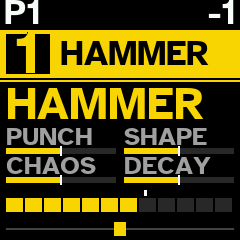
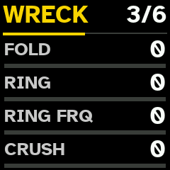
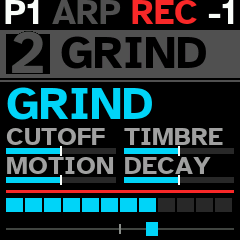
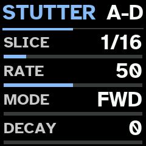
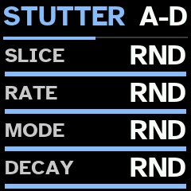
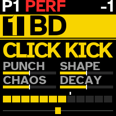
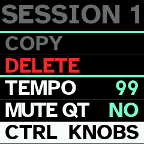
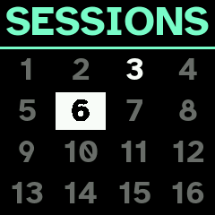
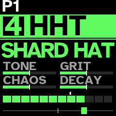

<p align="center">
  <picture>
    <source media="(prefers-color-scheme: dark)" srcset="docs/assets/logo-dark.svg">
    
  </picture>
</p>

# Quasar

A firmware for the M-VAVE FM-1, for experimental IDM, after the SOMA Pulsar-23.

Quasar models the Pulsar-23 as a whole instrument -- its BD, BASS, SD and HHT circuits, its SHAOS shift register,
LFO, clock and dividers, FX processor and distortion -- with an audio engine written from scratch for the FM-1's chip,
aimed at experimental IDM. 6 tracks, 16 engine profiles, 147 sound families, macros and internal routes, WRECK, a
stutter, a phrase generator with polymeters, 10 BREAK ways and a PERFORMANCE mode.

Website, browser installer and manual: <https://nzimas.github.io/quasar/>.

> [!WARNING]
> Quasar is unofficial. It is not made, endorsed or supported by M-VAVE or SOMA Laboratory, and installing it may
> void any warranty that applies to your FM-1. See the [disclaimer](#disclaimer).

## Install

From the browser: open the [installer](https://nzimas.github.io/quasar/install.html) in a desktop Chrome, Edge or
Opera, connect the FM-1 with a USB data cable and press Install. After installing, switch the FM-1 off and on once.

From the command line (macOS or Linux): `./setup.sh` once, then `./install.sh` (builds, then installs) or
`./install.sh FILE.fwsc` (installs a package). `./install.sh --info` says what the connected FM-1 runs.

# Manual

## Playing it

| Control | What it does |
| --- | --- |
| **6 top buttons** | choose track **1–6** (lit: chosen; glowing dimly: sounding). From any page, back to the track. In [MUTE mode](#mute-mode): mute and solo. |
| **PRESETS** knob | chosen track's [engine profile](#engine-profiles): **BD**, **HAMMER**, **SKIN**, **SD**, **WALL**, **WIRE**, **TONE**, **HHT**, **STATIC**, **METAL**, **SHAKE**, **GRIND**, **BASS**, **FM**, **PRC**, **PLUCK**. |
| **SHIFT + PRESETS** | new sound of the family before or after, within the profile. |
| **HOME** | new sound for the chosen track, from another family of its profile ([Sounds](#sounds)). |
| **SHIFT + HOME** | new sound of the same family. |
| **HOME held** (0.8 s) | save the session, as SAVE held. |
| **OCT− / OCT+** | chosen track's octave, −3 to +3. In the step view: track's [transposition](#transposition). |
| **SHIFT + OCT− / OCT+** | every track's transposition. |
| white keys | play the chosen track in the scale; the keys that play the root glow dimly. In the step view: track's 16 steps. On the PATTERNS and SESSIONS grids: 16 slots. |
| black key 1 | [CHORD mode](#chord-mode) on or off. **SHIFT +**: next chord form. |
| black key 2 | [MUTE mode](#mute-mode) on or off. |
| black key 3 | **held**: [BREAK](#break) on the chosen track. **SHIFT +**: on every track. |
| black key 4 | [MIDI LEARN](#midi-learn) on or off. |
| black key 5 | chosen track's [arpeggiator](#arpeggiator) on or off. **Held** (0.8 s): its page. |
| black key 6 | **SHIFT +** it **held**: the [STUTTER](#stutter) plays. **Held** alone (0.8 s): STUTTER page. |
| black key 7 | [PERFORMANCE](#performance) on or off. In the step view: **SHIFT +** it. |
| black key 9 (3rd from right) | **STEP**: [step view](#step-view). **SHIFT +**: empty the chosen track's steps. |
| black key 10 | **EDIT**: [sound pages](#sound-pages-edit). |
| black key 11 (last) | **SHIFT**. |
| **SELECT** knob | chosen track's level. On the SCALE page: root. |
| **ALGORITHM** knob | chosen track's pan. On the SCALE page: scale. |
| **KNOB 1–4** | chosen track's [macros](#macros) 1 to 4. On a page: its rows A–D. |
| **SHIFT + KNOB 1–4** | chosen track's DRIVE, FX send, ATTACK and macro 8. |
| **PLAY** | start or stop the [sequencer](#sequencer). **Held** (0.8 s): [TEMPO](#tempo) page. |
| **SHIFT + PLAY** | metronome on or off. |
| **REC** | [record](#recording) the keys into the chosen track's steps. |
| **SHIFT + REC** | [looper](#looper): arm a loop. **Held**: track's loops on the white keys. |
| **ARP** | SCALE page ([Scales](#scales)); ARP again leaves it. |
| **SHIFT + ARP** | new scale and root, drawn at random; the SCALE page shows them for 1.5 s. |
| **SEQ** | [panel pages](#effects-seq), then the chosen track's DUCK and [automation LFOs](#automation-lfos), in turn. |
| **SHIFT + SEQ** | chosen track's automation LFOs drawn anew. |
| **SAVE** | [PATTERNS](#patterns) grid; SAVE again leaves it. |
| **SAVE held** (0.8 s) | save the session. On the PATTERNS grid: save the pattern playing into the slot under the cursor. |
| **SHIFT + SAVE** | [SESSIONS](#sessions) grid; SHIFT + SAVE again leaves it. |
| **SHIFT + SAVE held** (0.8 s) | [GLOBAL SETUP](#global-setup): START and MIDI. |
| **MASTER** | output level. |
| MIDI in (USB and TRS) | notes and CCs for each track ([MIDI](#midi)). |

While a macro knob turns, the screen shows its value as a large dial for 1 s.



## Tracks and sounds

Quasar models the SOMA Pulsar-23 drum synthesizer with an engine written from scratch. It follows the instrument's
published behaviour; no circuit values were available, and it has not been compared by ear with a real Pulsar-23.
It is aimed at IDM 1st, rhythmic noise 2nd.

6 tracks, each with its own engine profile, sound, octave, level, pan, steps and loops. There are no subtracks. Each
track is 1 circuit and sounds 1 note at a time: a new note strikes it again at the new pitch. Every sound is
percussive: it falls once its attack peaks, whether the key is held or not.

There is no TUNE control. Every circuit takes its pitch from the note played, drums too, so drums follow the scale.
BD sounds 2 octaves below the note, the SD's pitched noise 4 above, the HHT's noise clock 6 above, BASS at the note;
each recipe sets an offset from it.

Velocity sets how hard a circuit is struck. The keys always play at full velocity.

The FM-1's 2nd processor core renders about half the sounding tracks. If it ever faults, the 1st core carries
on alone until the FM-1 is switched off, and the screen says **1 CORE**.

The start (and a new session): track 1 HAMMER, 2 GRIND, 3 WALL, 4 HHT, 5 SKIN, 6 STATIC, track 1 an octave down.

### Engine profiles

**PRESETS** chooses the chosen track's profile: a circuit and 1 of its modes. BD, SD, HHT and BASS are the
Pulsar-23's 4 voices; the others are modes written for Quasar that go past the instrument.

| Profile | Circuit | What it is |
| --- | --- | --- |
| **BD** | BD | the Pulsar's kick: a triangle core with a pitch sweep at each strike, shaped from triangle to sine to square. Kicks, toms, zaps |
| **HAMMER** | BD | the BD core folded over 1 to 9 times, a low noise rumble that outlasts the strike, a click and a hard clip: industrial impact, gabber, doom |
| **SKIN** | BD | a struck membrane, its fundamental and a 2nd mode, with a stick click: war toms, tabla, surdo |
| **SD** | SD | the Pulsar's snare: pink noise and a pitched noise, a clap, a resonant band-pass |
| **WALL** | SD | power noise: sample-rate crush, dropped bits, a rhythmic chop, a screaming band-pass and a hard clip. No clap |
| **WIRE** | SD | the snare noise through a comb 2 octaves above the note: buzz, rattle, tin |
| **TONE** | SD | 2 struck body modes against filtered noise: 808-style tone snares |
| **HHT** | HHT | the Pulsar's hat: noise resampled at a clock that follows the note, a spectrum warp, a resonant high-pass |
| **STATIC** | HHT | electrical crackle: impulses and short arcs ringing in the high-pass |
| **METAL** | HHT | 6 square oscillators at the 808's ratios, summed or ring-modulated: cymbals, scrap |
| **SHAKE** | HHT | noise in grains a few milliseconds long |
| **GRIND** | BASS | an oscillator pushed by its own overdriven filter, ring-modulated by noise: screams, howl, drills |
| **BASS** | BASS | the Pulsar's bass: a feedback oscillator from sine to saw to square, a warp shaper, a resonant low-pass, glide |
| **FM** | BASS | a 2-operator ping: gongs, clang, broken bells |
| **PRC** | BASS | 3 resonators struck by an impulse and noise, harmonic or a detuned cluster |
| **PLUCK** | BASS | a struck string: sitar buzz, piano wire |

A track keeps 1 sound for each of the 4 circuits (BD, SD, HHT, BASS), modes included. Turning PRESETS onto a profile
whose circuit's sound is in that mode finds it as it was; onto another mode of a circuit, it draws a new sound of
that profile, in place of the circuit's sound. So turning from SKIN to SD and back finds both; turning from HAMMER
to SKIN replaces the HAMMER sound. The MODE row of the [circuit page](#sound-pages-edit) changes the mode in place,
the sound's knobs kept.

### Sounds

**HOME** draws a new sound for the chosen track from another family of its profile: a recipe such as BURNT 909,
GABBER, WAR TOM, NOISE WALL, SHARD HAT, GEIGER, SCREAMER or BROKEN BELL. **SHIFT + HOME** draws another from the same
family; **SHIFT + PRESETS** moves to the family before or after, within the profile. The screen shows the profile
and the family. There are 147 families, all percussive and abrasive: no drones, no long decays.

| Circuit | Profiles (families) |
| --- | --- |
| BD | BD (19), HAMMER (11), SKIN (11) |
| SD | SD (12), WALL (10), WIRE (7), TONE (5) |
| HHT | HHT (13), STATIC (7), METAL (8), SHAKE (5) |
| BASS | GRIND (11), BASS (9), FM (7), PRC (6), PLUCK (6) |

Each family is a circuit setting, an envelope, a drive and FX send, and up to 4 [routes](#routes). Each drawing
moves every knob by the family's spread, picks each route's source and depth, varies the drive and send, adds a
further route half the time, and [wrecks](#wreck) about half the sounds. So SHIFT + HOME seldom gives the same sound
twice. Each family's VOL is set to level its hits against the others, hats about 6 dB under. SHAOS and the clock
dividers step drive, filters and level in the recipes, never pitch.

## Sound pages (EDIT)

Black key 10 (**EDIT**) shows the sound's 6 pages: the circuit's own (titled with the profile), ENV, WRECK, MACRO,
ROUTE 1 and ROUTE 3. **KNOB 1–4** set rows A to D; **PRESETS** turned right shows E to H, left goes back. **OCT− /
OCT+** move between the pages. EDIT again leaves. Values read 0 to 100.

### Circuit page

The circuit's knobs, named as its mode uses them; the last row is MODE.

| Profile | A | B | C | D | E | F | G |
| --- | --- | --- | --- | --- | --- | --- | --- |
| BD | AMT | PITCH | SHAPE | STAB | MODE | | |
| HAMMER | AMT | PITCH | FOLD | RUMBLE | MODE | | |
| SKIN | AMT | PITCH | HEAD | STICK | MODE | | |
| SD | AMT | CLAP | MIX | BPF FR | BPF Q | MODE | |
| TONE | AMT | CLAP | NOISE | BPF FR | BPF Q | MODE | |
| WIRE | AMT | CLAP | MIX | BPF FR | BUZZ | MODE | |
| WALL | CRUSH | CHOP | BITS | BPF FR | BPF Q | MODE | |
| HHT | WARP | HPF FR | HPF Q | MODE | | | |
| METAL | RING | HPF FR | HPF Q | MODE | | | |
| SHAKE, STATIC | DENSITY | HPF FR | HPF Q | MODE | | | |
| BASS, PRC | SHAPE | WARP | AMT | LPF FR | LPF Q | GLIDE | MODE |
| PLUCK | BRIGHT | SUSTAIN | AMT | LPF FR | LPF Q | GLIDE | MODE |
| FM | RATIO | INDEX | AMT | LPF FR | LPF Q | GLIDE | MODE |
| GRIND | FDBK | RING | AMT | LPF FR | LPF Q | GLIDE | MODE |

- **AMT** sets how far a route into the circuit's modulation input moves it (BD: MOD, the pitch; SD: TUNE; BASS: PM).
  With no route there, it does nothing.
- **PITCH** (BD): depth and decay of the pitch sweep at each strike. **STAB**: the core restarts at each strike.
- **CLAP** (SD, TONE, WIRE): 1 to 4 bursts. It sounds only on hits of velocity 113 or more (a step's VEL 89 or more);
  the keys always clap.
- **MODE**: BD: TRI, SKIN, HAMMER; SD: NOISE, TONE, WIRE, WALL; HHT: NOISE, METAL, SHAKE, STATIC; BASS: DCO, PRC,
  PLUCK, FM, GRIND. Changing it changes the profile.

### ENV

ATT (attack, from 0.3 ms to about 5 s), REL (release), VOL (the sound's level; each family's own at first), FX (its
send to the [FX processor](#effects-seq)) and, on E, DRIVE (the voice's overdrive, also on SHIFT + KNOB 1 and the MACRO
page). REL stops growing at 57: every sound is short.

### WRECK



A stage after the sound's overdrive: **FOLD** (a triangle wavefolder), **RING** (a ring modulator with its own sine),
**RING FRQ** (its frequency, 20 Hz to 5 kHz, whatever the note), **CRUSH** (sample-rate reduction), and on E,
**BITS** (up to 12 bits dropped). All at 0 bypass it. About half of all new sounds come with 1 or 2 of them.
Phrases lock them step by step, and BREAK's WRECK layer throws them onto single hits.

### Macros

KNOB 1–4 on the track's view turn the sound's macros 1 to 4, and SHIFT + KNOB 1–4 its macros 5 to 8. The MACRO page
shows all 8. The names depend on the circuit:

| Circuit | KNOB 1 | KNOB 2 | KNOB 3 | KNOB 4 | SHIFT + 1 | SHIFT + 2 | SHIFT + 3 | SHIFT + 4 |
| --- | --- | --- | --- | --- | --- | --- | --- | --- |
| BD (BD, HAMMER, SKIN) | PUNCH | SHAPE | CHAOS | DECAY | DRIVE | FX | ATTACK | BEND |
| SD (SD, WALL, WIRE, TONE) | TONE | SNAP | CHAOS | DECAY | DRIVE | FX | ATTACK | RING |
| HHT (HHT, STATIC, METAL, SHAKE) | TONE | GRIT | CHAOS | DECAY | DRIVE | FX | ATTACK | RING |
| BASS (GRIND, BASS, FM, PRC, PLUCK) | CUTOFF | TIMBRE | MOTION | DECAY | DRIVE | FX | ATTACK | RESO |

Macros 1–4 and 8 move the sound about its recipe: 50 is the recipe as drawn (the white tick on the screen's bars),
lower takes away, higher adds. Each moves up to 4 of the circuit's knobs at once:

| Circuit | Macro | What it moves |
| --- | --- | --- |
| BD | PUNCH | the pitch sweep up, release a little shorter, SHAPE a little |
| | SHAPE | SHAPE (triangle towards square; FOLD on HAMMER, HEAD on SKIN) |
| | CHAOS | AMT |
| | DECAY | release, and a little more pitch sweep |
| | BEND | AMT, less far |
| SD | TONE | band-pass frequency, the pitch, MIX |
| | SNAP | CLAP up, MIX down, band-pass Q up |
| | CHAOS | AMT |
| | DECAY | release |
| | RING | band-pass Q |
| HHT | TONE | high-pass frequency, the pitch |
| | GRIT | WARP up, the pitch down, Q a little |
| | CHAOS | nothing directly: only routes set to M3 |
| | DECAY | release |
| | RING | high-pass Q up, frequency a little down |
| BASS | CUTOFF | low-pass frequency, WARP a little |
| | TIMBRE | SHAPE, WARP, Q a little |
| | MOTION | AMT |
| | DECAY | release, cutoff a little down |
| | RESO | low-pass Q, cutoff a little down |

The knobs moved keep their meaning in the mode: SNAP on WALL moves CHOP and BITS. A [route](#routes) set to M1–M4 or
M8 is scaled by that macro too (0 off, 50 as set, 100 about 2×), so CHAOS and MOTION open or close a sound's
modulation.

Macros 5–7 are the sound's own DRIVE, FX send and ATTACK. **DRIVE** is the voice's overdrive: a pre-emphasis, an
asymmetric clipper whose bias sags with the level, and a de-emphasis that darkens as it rises; the level stays about
the same, so it thickens rather than gets louder. At 0 it is bypassed.

### Routes

ROUTE 1 shows routes 1 (A–D) and 2 (E–H); ROUTE 3 routes 3 and 4. Each route is a patch cable inside the sound:

| Row | What it sets |
| --- | --- |
| SRC | the source: -- (none), a pin of any track (1 OUT, 2 ENV ...), OWN OUT and OWN ENV (the track the sound is on), NOISE, the clock and its dividers (CLK, DIV 16 to DIV .25), SHAOS's outputs (SH 1B, SH 2B, SH 1B SH, SH 3B SH), the LFO (LFO SQR, LFO TRI), the FX outputs, and the panel's other pins |
| DST | where it goes. BD: EXT, MOD, WTF?, OMG!, DRIVE, VCA. SD: EXT, TUNE, BPF, DRIVE, VCA. HHT: EXT, TUNE, HPF, DRIVE, VCA. BASS: EXT, CV IN, SHAPE, WARP, PM, LPF, DRIVE, VCA |
| DEPTH | −127 to +127; on VCA, negative ducks |
| MACRO | -, or M1 to M8: the macro that scales it (M5 to M7 do not) |

EXT feeds the source into the circuit as audio; DRIVE and VCA push the sound's drive and level. A route from another
track's OUT gives cross-modulation and feedback between tracks. The panel's utility pins (VCAs, switches, attenuators,
pulse converters, diode, capacitors, TOUCH and MIDI CV) need cables on the Pulsar-23; Quasar has none, so they give
nothing useful. A route arrives about 0.73 ms late; those other than EXT are followed every 4th sample.

## Keys and scales

The white keys play the chosen track in the scale: the 1st key is the root, each key the next degree. The keys
that play the root glow dimly. USB and TRS MIDI notes play the chosen track as the keys do ([MIDI](#midi)).

### Scales

**ARP** opens the SCALE page: **SELECT** sets the root, **ALGORITHM** the scale. ARP again, or a track button, leaves
it. **SHIFT + ARP** draws a scale and a root at random and shows them for 1.5 s over any page. The scale and root
belong to the session. A new session draws them at random.

The scales: CHROMATIC (black key 8 plays too), MAJOR, MINOR NATURAL, MINOR HARMONIC, DORIAN, PHRYGIAN, MINOR PENTA,
MAJOR PENTA, WHOLE TONE, JAPANESE IN, MINOR MELODIC, ENIGMATIC, LYDIAN, MIXOLYDIAN, LOCRIAN, BLUES, HUNGARIAN MINOR,
DOUBLE HARMONIC, PHRYGIAN DOMINANT, JAPANESE HIRAJOSHI, JAPANESE IWATO, PELOG, OCTATONIC, PROMETHEUS.

### Transposition

In the step view, **OCT− / OCT+** move the chosen track's steps and loops 1 step of the scale down or up (in
CHROMATIC, a semitone). **SHIFT + OCT− / OCT+**, in the track's view or the step view, move every track's. Notes stay
in the scale. The transposition shows at the top right, beside the octave (T+2, T−1), up to 24 steps each way. It is
part of the pattern: saved with it, and copied with it. It moves only the loops of the pattern playing; a loop being
recorded is left as it is. The keys' octave does not change.

### CHORD mode

Black key 1 turns CHORD mode on or off for the chosen track (lit while on). Each white key then gives a chord from its
note, in the scale. **SHIFT +** black key 1 chooses the next form: TRIAD, INV 1, INV 2, SUS2, SUS4, OPEN, FOURTHS.
The form shows at the top left. Steps, recording and the looper take the chords. Tracks on the BD circuit (BD,
HAMMER, SKIN) take no chords: NO CHORDS shows.

A track sounds 1 note at a time, so a chord is heard as its last note only. CHORD mode matters most as a way to
write chords into steps and loops, and to feed the [arpeggiator](#arpeggiator).

### Arpeggiator

Black key 5 turns the chosen track's arpeggiator on or off (lit while on; ARP shows at the top left). The keys held,
and MIDI notes for the track, then play 1 at a time on the tempo's grid: with the sequencer's 16ths while it plays,
on their own at the tempo while it is stopped. With CHORD mode on, each key gives it the chord's notes.

**Hold black key 5** (0.8 s) to open or close the ARP page (KNOB 1–4 rows A to D; PRESETS right, E to H):

| Row | What it sets |
| --- | --- |
| MODE | UP, DOWN, UP DOWN, DOWN UP, ORDER (as played), RANDOM, CONVERGE (from the ends in), DIVERGE (from the middle out), PINKY (the top note between each of the others), THUMB (the lowest between each) |
| RATE | 1/32, 1/16T, 1/16, 1/8T, 1/8, 1/4 |
| RANGE | 1 to 4 octaves |
| GATE | each note's length, 0 to 100 |
| LATCH | OFF, ON: the notes keep playing with the keys up, until the next chord |
| DENSITY | chance that each note plays, 0 to 100 |
| OCT RND | chance that a note jumps an octave, 0 to 100 |
| BASS | OFF, or EVERY 2 to EVERY 8: every so many notes, the lowest an octave down |

REC records the arpeggio into the steps and SHIFT + REC into a loop; with either armed, its first note starts the
sequencer. The arpeggiator and its settings are saved with the session and the pattern.

### MUTE mode

Black key 2 turns MUTE mode on or off (lit while on; the screen reads MUTE MODE). The track buttons then mute instead
of choosing:

| To | Do this |
| --- | --- |
| Mute a track, or bring it back | press its button (lit: playing; dim: muted) |
| Solo a track | hold its button 1 s |
| End the solo | hold it 1 s again: the mutes come back as they were |

A muted track fades out, its FX send with it; its steps keep running silently. Its bar on the screen turns grey. The
mutes stay when MUTE mode is turned off. They are saved with the pattern. MUTE mode also works on the PATTERNS grid.



**MUTE QT** (on the session's page, saved with the session): with YES, a mute, unmute or solo waits for the start of
the pattern's next cycle, the moment the chosen track begins its steps again (as a pattern switch does), and its
button blinks until then. Stopped, it happens at once. Choosing a pattern drops mutes still waiting: the pattern
brings its own. With NO (at first), they happen at once.

### BREAK

While the sequencer plays, **hold black key 3** to break up the chosen track's pattern; **SHIFT +** it, every track's.
It works from any page out of the step view, and on the PATTERNS grid. Nothing is written into the steps: when the
key is let go, the pattern carries on from where it would have been.

Each press draws a plan: 1 way of playing the steps, shown on the screen, and layers on top. Held, a new plan comes
about every other bar, never the same way 2 times running. The break starts on the track's next beat:

| Way | What plays |
| --- | --- |
| REPEAT 1, 2, 4 or 8 | window of that many steps, played over and over |
| HALF TIME | steps at half speed |
| DOUBLE | steps at double speed |
| REVERSE 4 or 8 | each window of 4 or 8 steps backwards, its 1st step in place |
| CHOP | bar's 4 beats shuffled, the 1st in place |
| ROLL | steps as written, with more ratchets |
| SHUFFLE | bar's 16 steps in another order |
| POLY | each track round its own window of 3, 5, 6, 7 or 9 steps, against the bar |
| JUMP | each beat a leap to another beat |
| SKIP | steps read 3, 5, 7, 9 or 11 at a time through the bar |

The layers, each drawn at random (at least 1): ratchets (up to 8, faster the longer the key is held), octave leaps
on melodic tracks, flams on drums, accents (full on the beat, softer between), **RISE** (hits climbing in pitch
through each half bar), **WRECK** (single hits folded, crushed, bit-reduced or rung), **STUT** (the
[STUTTER](#stutter) thrown in for a beat or so, with its own slice, speed and roll) and **GHOST** (soft hits on empty
steps). A kick keeps the bar's 1st step, takes few ratchets and no leaps, rises or ghosts. Nothing drops out. Loops
play on as recorded.

**Saving a break.** On the PATTERNS grid, with black key 3 held and the sequencer playing, hold a white key 0.8 s: the
break, as it plays, is saved into that pattern slot (BREAK SAVED, PATTERN n). It keeps the way, ratchets, octave
leaps, flams, accents and RISE; not WRECK, STUT or GHOST. The pattern playing goes on.

## Effects (SEQ)

**SEQ** shows the Pulsar-23's panel pages SHAOS, LFO, FX and MIX, then the chosen track's DUCK and AUTO 1 to 3, in
turn, then goes back. **OCT− / OCT+** move between them. **KNOB 1–4** set the first 4 rows; **PRESETS** turned right
shows the next 4. A track button goes back to the track; **SHIFT +** a track button chooses another track and stays
on the page. The panel belongs to the session.

| Page | Rows |
| --- | --- |
| SHAOS | FREQ, LENGTH (63, 16, 217): the shift register's rate and the length of its cycle. It moves the routes that read SH 1B, SH 2B, SH 1B SH or SH 3B SH |
| LFO | FREQ, SHAPE (falling saw to triangle to rising saw), RANGE (LOW, MID, HI), MOD AMT. It moves the routes that read LFO SQR or LFO TRI. MOD AMT does nothing: no cable reaches the LFO's MOD input |
| FX | MODE (BPF, DBL, PCH), FX TO (DLY, REV), TIME, TUNE; then FB, CLK MOD, MAD! (OFF, ON) |
| MIX | DLY OUT, REV OUT (the FX returns), DRIVE, DIST MIX (the parallel distortion on the whole mix) |
| DUCK | chosen track's SC SOURCE and SC LEVEL ([Sidechain](#sidechain-duck)) |
| AUTO 1–3 | chosen track's [automation LFOs](#automation-lfos) |

The Pulsar-23's CLOCK, LOOPER, ATTEN, CV and PATCH pages are not shown: without cables none of them sounds, and Quasar
runs with no cables. The clock follows the session tempo.

**The FX processor** is 1 delay and 1 reverb, after the Pulsar-23's. Every sound's FX send goes to the delay or to
the reverb, as **FX TO** says. **TIME** sets the delay (1 ms to about 0.6 s; it does not follow the tempo), **FB** the
delay's feedback and the reverb's decay. **MODE**: BPF puts a band-pass (**TUNE**) in the delay's feedback; DBL a
2nd tap (TUNE); PCH a pitch shifter of up to an octave either way (TUNE) in the delay, and the opposite one in the
reverb. **MAD!**: in BPF and PCH, delay reads that follow the signal, feedback past unity with clipping, random pitch
jumps; in DBL, stereo outputs. CLK MOD does nothing: it needs a cable.

### Sidechain (DUCK)

On the DUCK page, **SC SOURCE** chooses whose hits duck the chosen track (OFF, or T1 to T6) and **SC LEVEL** how deep,
0 to 100. The duck follows the source sound's envelope: it lets go as the source's hit dies away. The track's FX send
ducks with it. Both are saved with the pattern.

### STUTTER

A beat repeat of the whole output, on its own (not through the FX). **Hold SHIFT and black key 6** (in either order; the step view
off): it takes the slice just heard (on the next 32nd while the sequencer plays, at once while it is stopped) and plays
it round and round in place of the mix until either key is let go. The music carries on underneath, and comes back as
the keys are let go. STUTTER shows while it plays.

**Hold black key 6 alone** (0.8 s) to open or close the STUTTER page (key lit while it plays or the page is up):



| Row | What it sets | At first |
| --- | --- | --- |
| SLICE | 1/32, 1/16, 1/8, 1/4, 1/16T, 1/8T of the tempo, or RND | 1/16 |
| RATE | 50 as heard; lower slower and darker, higher faster; past 100, RND | 50 |
| MODE | FWD, REV, ALT (turning each pass), WILD (each pass its own way and speed), RND | FWD |
| DECAY | each pass quieter; past 100, RND | 0 |
| DRIFT | each pass slower below 50, faster above | 50 |
| ROLL | the slice halving every few passes, faster as it rises | 0 |
| MIX | how much of it over the music | 100 |

A row set to RND draws a new value each time SHIFT and the key are pressed (any slice, rate, mode, WILD among them, or
decay), so every press is different. The STUTTER page's settings are kept with the session.



### Automation LFOs

Each sound has 3 LFOs, on the pages AUTO 1 to 3. They belong to the sound, so each circuit's sound on a track has its
own, and they are saved with the session. They move the track's sound as a whole.

| Row | What it sets |
| --- | --- |
| SPEED | −64 to +63; negative runs the wave backwards. SPEED +32 with MULT x4 is 1 bar |
| MULT | x1 to x2048 follow the tempo; .1 to .2048 run as at 120 BPM whatever the tempo |
| FADE | 0 none; negative fades the LFO in, positive fades it out, from each note |
| DEST | NONE, or a parameter of the sound. AUTO 2 can also move AUTO 1's SPEED or DEPTH, and AUTO 3 those of AUTO 1 or 2 |
| WAVE | TRI, SINE, SQR, SAW, EXP, RAMP, RND (a new random value each cycle) |
| START | where the wave starts on a note. For RND: how smoothly it moves to each new value |
| MODE | FREE runs on; TRIG starts again on each note; HOLD holds its value from each note to the next; ONE runs 1 cycle from each note; HALF half a cycle |
| DEPTH | −64 to +63, how far each way; negative turns the wave upside down; 0 off |

DEST names a parameter with a short prefix: **S1** the circuit page, **S2** ENV, **S3** MACRO (macro 6 not), **F1**
WRECK; **AMP** lists ATT, REL and VOL again, **FX** VOL, DRIVE, FX, REL and ATT again. The routes cannot be moved.

**SHIFT + SEQ** draws the chosen track's 3 LFOs anew (LFO RANDOM): 2 or 3 of them on, each to a different
parameter, with any wave, speed, mode and depth. Press it again for another. LFO settings cannot be step-locked.

## PERFORMANCE

Black key 7 (in the step view, **SHIFT +** black key 7; also on the PATTERNS grid) turns PERFORMANCE on or off, after
Elektron's temporary edits and CONTROL ALL. The key is lit while it is on, and PERF shows in red on the status line.



Turned on, it keeps the state playing: every track's sound, the steps and their locks, lengths, clocks and
directions, levels, pans, mutes, octaves, chords, arpeggiators, sidechains, the panel and STUTTER pages, tempo, scale
and MUTE QT. Change anything: sounds, EDIT pages, phrases, steps, breaks. Turned off, all of it is put back as it was
(RESTORED), and nothing is left marked unsaved. Sounds still ringing are not cut; they and the FX tails ring out.
Loops are not part of it: a loop recorded or emptied meanwhile stays so. With a pattern on its way, it does not turn
on: WAIT shows.

While it is on, **KNOB 1–4** (and SHIFT + them) turn that macro on the chosen track and on every other track with
notes (steps or a loop), each moving whatever that macro moves on its own sound, by the same steps.

**Keeping a pattern.** SAVE still opens the PATTERNS grid: hold a white key 0.8 s (or SAVE, on the cursor's slot) to
keep what is playing as that pattern, its steps and the tracks' state. Keeping a pattern also keeps the session as it
plays at that moment (sounds, panel, tempo, scale); changes made after the last pattern kept are undone as PERFORMANCE
goes off. If no pattern is kept, nothing stays. The machine returns to the pattern it started on; if it was kept over,
as kept.

Meanwhile, sessions (SHIFT + SAVE, SAVE or HOME held), switching patterns (keys or program changes), and copying,
pasting or emptying patterns wait till it is off: PERF MODE shows.

### CTRL ALL

**CTRL** on each session's page (CTRL KNOBS or CTRL ALL; saved with the session) sets what else follows the chosen
track while PERFORMANCE is on:



- **KNOBS** (at first): only the macros.
- **ALL**: also a new phrase or new locks (black key 1, SHIFT + it, in the step view), a direction, the TRACK page's
  LENGTH and CLOCK, the PHRASE page's DENSITY and COMPLEXITY, the step view's transposition, HOME's and SHIFT +
  HOME's new sound, and every turn on an EDIT page: the same page and row on each other track, by the same steps
  (on another circuit that row may be another parameter). Lists, such as MODE and the routes' SRC, DST and MACRO,
  are left alone.

Each track does it on its own steps and sound; tracks without notes are left alone.

## Sequencer

Each track has 16 steps, with its own length (1 to 16), clock (1/8, 1/4, 1/2, 1X, 2X, 4X) and direction. **PLAY**
starts and stops it. The Pulsar-23's clock and its dividers restart with PLAY.

### Step view

Black key 9 (**STEP**) turns the step view on or off. The white keys are then the chosen track's 16 steps: lit, a note;
dim, empty; the step playing the other way round; past the track's length, dark. Steps are silent while you edit them.

| To | Do this |
| --- | --- |
| Put a note in | press an empty step: the track's last note (or chord) goes there |
| Empty a step | press a step with a note, and let go |
| Lock a macro on a step | hold the step and turn KNOB 1–4 (macros 1–4) or SHIFT + KNOB 1–4 (DRIVE, FX, ATTACK, macro 8) |
| Lock the level or pan | hold the step and turn SELECT (the sound's VOL) or ALGORITHM (pan) |
| Lock a sound parameter | hold the step with the EDIT pages up and turn a knob; up to 8 locks a step |
| Copy a step | SHIFT + hold it 0.8 s (COPY blinks) |
| Paste it | SHIFT + hold another step 0.8 s, on this track or another |
| Empty the whole track | SHIFT + STEP (with the step view on or off): its steps and locks; the rest of the track is kept |

Any EDIT row can be locked, MODE and the routes included: a step can play the circuit in another mode.

The black keys, lit dimly, do this in the step view:

| Key | What it does |
| --- | --- |
| black key 1 | new [phrase](#phrases) for the track. **SHIFT +**: new locks on its steps. **Held** (0.8 s): PHRASE page |
| black key 2 | TRACK page: LENGTH and CLOCK |
| black key 3 | TRIG on or off: a step held shows its own page |
| black key 4 | MOD on or off: a step held shows its MOD page |
| black keys 6, 7, 8 | track's direction: REVERSE, PING-PONG, RANDOM; pressed again, forwards |
| SHIFT + black key 7 | [PERFORMANCE](#performance) on or off |

### Step pages

**TRIG**: KNOB 1 the step's note (in the scale), 2 its velocity, 3 its length, 4 its trig condition; with PRESETS turned
right, KNOB 1 its RATCHET (the step played 2, 3, 4, 6 or 8 times). The conditions are the Digitone II's: PRE and !PRE
(as the last condition was met or not), NEI and !NEI (as the track before met its condition), 1ST and !1ST (the 1st
time through), probabilities, and A:B (the A-th time of every B).

**MOD**: KNOB 1 MUTATE (the note moved by up to N steps of the scale, or RND), 2 MUT EVERY (how often), 3 MIDI FX
(ECHO, ECHO UP, ECHO DN, STUTTER, FLAM, LATE, GRACE, FIFTH, TRIAD, OCT UP, OCT DN, DROP), 4 FX EVERY. FIFTH, TRIAD and
the octaves sound with the note, so on a track that sounds 1 note at a time the added note takes its place.

### Phrases

In the step view, black key 1 writes a new phrase for the chosen track: steps, notes, velocities, lengths, conditions,
ratchets, MIDI FX and locks, made for the role of its family (KICK, SNARE, HAT, PERC, NOISE, BASS, LEAD). Rhythms are
straight, broken, Euclidean or clustered, aimed at IDM and rhythmic noise rather than a dance floor.

A phrase also sets the track's length, clock and direction:

- **Polymeters**: most often the track gets its own length (5, 7, 9, 11, 13 steps and others) against the bar; kicks
  less often.
- Hats, noise and percussion sometimes run 2× as fast or at half speed; any role but the kick sometimes runs
  backwards, ping-pong or at random.
- A **generative layer**, about 1 phrase in 3 and more often as COMPLEXITY rises: 2 Euclidean rhythms of other
  lengths crossed over the steps, ratchets mostly in 3s, hits pulled late or graced, velocities walking,
  conditions on most steps.

The locks move the macros (cutoff, drive, decay, attack, FX send, macro 8), the VOL, the pan and WRECK (BITS, CRUSH,
FOLD, RING) step by step. **SHIFT +** black key 1 draws new locks only, the notes kept.

Hold black key 1 (0.8 s) for the PHRASE page: **DENSITY** (KNOB 1) and **COMPLEXITY** (KNOB 2), 0 to 100, 50 at first.
DENSITY below 50 thins the phrase out (the strong steps last); above, it adds ghosts. COMPLEXITY below 50 takes locks
away; above, it adds locks, ratchets, MUTATE and MIDI FX, and makes polymeters and the generative layer more likely.
Both are kept with the pattern.

## Recording

**REC** records the keys into the chosen track's steps, each note with its velocity and length, until REC again.
Stopped, REC arms (it flashes, the metronome counts in) and the first note starts the sequencer. **SHIFT + PLAY**
turns the metronome on or off (on at first); it clicks while REC or the looper is armed or recording.

## Looper

**SHIFT + REC** arms a loop on the chosen track; the first note starts it (and the sequencer, if stopped). **REC** ends
it. Its length is rounded to whole bars (1 to 32), so it stays in time with the steps (LOOP 1  4 BARS shows). 3
loops a track, up to 256 notes each.

| To | Do this |
| --- | --- |
| See the track's loops | hold SHIFT + REC: they show on white keys 1–3 (lit: playing; dim: muted) |
| Mute a loop, or bring it back | with SHIFT + REC held, press its key |
| Empty a loop | with SHIFT + REC held, hold its key 0.8 s |
| Empty all the track's loops | hold SHIFT + REC 1.5 s without touching a key |

A loop belongs to the pattern it was recorded in. Another pattern does not play it, and an empty pattern plays
nothing. When a pattern comes in, its loops start with its steps. Saving, copying or pasting a pattern takes its loops
along; emptying it removes them. All patterns share room for 40 loops and 4608 notes: when it is full, arming a loop
shows NO ROOM, and a pattern saved into another slot shows LOOPS LOST for the loops that did not fit.

This is the FM-1's event looper, from Bigorna. The Pulsar-23's own looper-recorder is in the engine, but Quasar does
not show it.

## Tempo

**Hold PLAY** (0.8 s) for the TEMPO page: **PRESETS** sets the session's tempo, 10 to 300 BPM. A track button leaves
it. The tempo is also a row of the session's page.

## Patterns

A session has 16 patterns. A pattern holds every track's steps (with their length, clock, direction, transposition,
DENSITY and COMPLEXITY), its loops, and each track's mute, circuit, octave, level, pan, sidechain, CHORD mode and
arpeggiator. The sounds, the panel and STUTTER pages, the tempo, the scale and the root belong to the session.

**SAVE** opens the PATTERNS grid; SAVE again leaves it. The white keys are the 16 patterns, the one playing brighter.
On the screen the pattern playing is green (orange with changes not saved), saved patterns white, empty ones grey, and
the white square is the cursor: it opens on the pattern playing, and **PRESETS** moves it.

| To | Do this |
| --- | --- |
| Play a pattern | press and release its white key. While the sequencer plays, it starts at the end of the chosen track's steps |
| Save the pattern playing into a slot | hold the slot's white key 0.8 s, or move the cursor there and hold SAVE; the slot may be empty or not, and the pattern playing goes on |
| Save its changes in its own slot | hold its own white key 0.8 s |
| Copy a pattern | SHIFT + hold its key 0.8 s |
| Paste it | SHIFT + hold another key 0.8 s |
| Empty a pattern | hold SHIFT and black key 1, and press its key |
| Leave the grid | SAVE, or a track button |

A changed pattern keeps its changes when you switch away, until the session is saved or loaded. A pattern that
unmutes a track starts that track cleanly, without notes left over from the muted time. Every note is always saved;
on a pattern crowded with locks, the last locks may be left out. MUTE mode (black key 2), BREAK (black key 3) and
PERFORMANCE (black key 7) work on the grid too, and MIDI program changes 0 to 15 choose patterns 1 to 16
([MIDI](#midi)).

A pattern keeps each track's circuit, not its mode: the mode is the session's sound on that circuit.

## Sessions

16 sessions are kept in the FM-1's flash. A session holds everything: every track's sounds and settings, the panel and
STUTTER pages, CTRL, the tempo, the scale and root, MUTE QT, the 16 patterns with their loops, and the pattern playing.



**SHIFT + SAVE** opens the SESSIONS grid, laid out as the PATTERNS grid; SHIFT + SAVE again leaves it. The white keys
are the 16 slots (lit dimly; the session playing brighter). On the screen the session playing is green (orange with
changes not saved), saved sessions white, empty ones grey, and the white square is the cursor.

| To | Do this |
| --- | --- |
| Load a session | press and release its white key: it loads at once. With changes not saved, UNSAVED: AGAIN shows; press the same key again within 2 s |
| Save the session playing into a slot | hold the slot's white key 0.8 s; empty or not, it is saved there without asking |
| Open a session's page | move the cursor with **PRESETS**, then **SAVE** |

The session's page has BACK, LOAD, SAVE, COPY, DELETE, TEMPO, MUTE QT ([MUTE mode](#mute-mode)) and CTRL
([CTRL ALL](#ctrl-all)). PRESETS chooses a row; SAVE runs it, or moves to its value (PRESETS changes it, SAVE sets
it, SHIFT + SAVE leaves it as it was). SHIFT + SAVE goes back to the grid. Loading over changes not saved, saving over
another session, copying over one and deleting ask first: NO or YES on PRESETS.

| To | Do this |
| --- | --- |
| Save the session playing | hold SAVE (or HOME) 0.8 s, away from the SESSIONS pages and the PATTERNS grid. Never saved, it offers the first empty slot (SAVE NEW?) |
| Start a new session | SAVE on an empty slot's page: the start's profiles with new sounds, a scale and root at random, tempo 120, no patterns or loops. It asks first if the session playing has changes not saved. With nothing saved yet, it saves what is playing there instead |
| Copy a session into another slot | its page, COPY, then the slot |
| Delete a session | its page, DELETE |

Loading a session brings all of it back; while the sequencer plays, its loops start at the next bar. Loops take room
in a store shared by all the sessions: if it is full, NO ROOM FOR LOOPS shows and nothing is saved; deleting a session
frees room. Changes not saved before the FM-1 is switched off are lost. During [PERFORMANCE](#performance), sessions
wait: PERF MODE shows.

Quasar keeps its sessions in the flash area Bigorna and Tonitor use. It does not read their sessions (their slots
look empty), and saving into a slot overwrites what another firmware kept there. Back up before switching firmware.

How the FM-1 starts is set in [GLOBAL SETUP](#global-setup) > START: with a new session (NEW) or the last session
loaded or saved (LAST).

### Backup

The [Backup page](https://nzimas.github.io/quasar/backup.html) (desktop Chrome, Edge or Opera, over USB MIDI) copies every session, with its patterns
and loops, and GLOBAL SETUP to a file on the computer, and writes them back. Use it before installing another
firmware. A restore puts each session back into its own slot and leaves the others; RESTORED S3 (or SETUP) shows as
each lands.

## GLOBAL SETUP

**SHIFT + SAVE held** (0.8 s) opens GLOBAL SETUP: the FM-1's own settings, kept apart from the sessions. **PRESETS**
moves through the entries; **SAVE** opens one, or moves to a value and sets it; **SHIFT + SAVE** leaves a value as it
was or goes back a level. A track button leaves. Changes are saved as you leave.

**START**: how the FM-1 starts. **NEW** (at first): with a new session: new sounds on every track, a scale and root at
random, tempo 120. Hold SAVE to keep it. **LAST**: with the last session loaded or saved.

### MIDI

MIDI goes over the USB cable both ways (the FM-1 shows up as FM-1 Quasar) and comes in through the 3.5 mm MIDI IN
jack (TRS Type A). The settings follow the Model:Cycles' MIDI CONFIG:

| Part | Settings | At the start |
| --- | --- | --- |
| SYNC | CLK IN: follow a MIDI clock and its transport; CLK OUT: send them; PCH IN: a program change chooses the pattern; PCH OUT: send one when a pattern is chosen (ON / OFF) | all OFF |
| IN CHAN | TRACK 1 to 6: the channel each track listens on; AUTO: the channel that plays the chosen track; PCH: the program changes' channel | 1 to 6; AUTO 16; PCH 16 |
| OUT CHAN | TRACK 1 to 6: the channel each track sends on; PCH | 1 to 6; PCH 16 |
| RECEIVE | NOTES, CC (ON / OFF) | ON, ON |
| SEND | NOTES, CC (ON / OFF) | OFF, OFF |
| PORTS | USB IN, TRS IN: take MIDI from USB, from the jack (ON / OFF) | ON, ON |

**Clock in.** With CLK IN on, the FM-1 follows the clock that arrives: its tempo, START (from step 1), CONTINUE (from
the song position) and STOP. The sending device must send its transport as well as its clock. The TEMPO page shows
EXT TEMPO. If the clock stops for 0.5 s, the FM-1 goes back to its own tempo.

**Clock out.** With CLK OUT on, the FM-1 sends its clock all the time, so another device can lock to it before it
starts; PLAY sends START, stopping sends STOP.

**Notes.** A note on a track's IN channel plays that track; on the AUTO channel, the chosen track. Notes on the chosen
track are recorded as the keys are. With SEND NOTES on, every note a track plays (steps, loops, keys, notes received)
goes out on its OUT channel; a muted track sends nothing.

**CCs.** Each track answers to these CCs on its channel: level 7, pan 10, mute 94 (64 and up mutes), and:

| Page | A | B | C | D | E | F | G | H |
| --- | --- | --- | --- | --- | --- | --- | --- | --- |
| circuit page | 16 | 17 | 18 | 19 | 20 | 21 | 22 | 23 |
| ENV | 24 | 25 | 26 | 27 | 28 | | | |
| MACRO | 33 | 34 | 35 | 36 | 37 | 39 | 40 | 41 |
| ROUTE 1 | 42 | 43 | 44 | 45 | 46 | 47 | 48 | 49 |
| WRECK | 50 | 51 | 52 | 53 | 54 | | | |
| ROUTE 3 | 58 | 59 | 60 | 61 | 62 | 63 | 70 | 71 |

The ENV page's values also answer to ATT 72 or 86, REL 74, 76 or 85, VOL 79 or 80, DRIVE 81 and FX send 84. A CC
sets its parameter over its whole range; on the circuit page, the CC for MODE changes the profile. With SEND CC on,
turning a parameter sends its page's CC, and the level, pan and mutes as they change.

**Program changes** 0 to 15 choose patterns 1 to 16, in time as the PATTERNS grid does.

The jack takes everything USB does except SysEx. With both inputs on they are merged; a clock should come from only
1 of them. A controller cannot be plugged straight into the FM-1's USB-C port (both are USB devices and need a
computer between them); a controller with a 5-pin MIDI OUT goes into the jack.

### MIDI LEARN

Black key 4 turns MIDI LEARN on or off (lit while on; the screen reads MIDI LEARN), on the track's view, the EDIT pages
and the SEQ pages. The EDIT and SEQ pages then show, in each row, the CC learned for it, or -- if none. **PRESETS**
chooses the row; **OCT− / OCT+** turn the pages.

| To | Do this |
| --- | --- |
| Learn a CC | SAVE (WAIT shows), then move the control: the next CC to arrive, on any channel, is learned |
| Stop waiting | SAVE again |
| Forget the row's CC | SHIFT + SAVE |

A learned sound parameter moves on the track it was learned on; a panel page's for all; DUCK and AUTO rows on their
track. The ARP page, AUTO's DEST rows and the pages not shown cannot be learned. Each CC and channel
controls 1 parameter, and each parameter has 1 CC. Up to 64 are kept, with GLOBAL SETUP. RECEIVE CC must be on.

## USB audio

Plugged into a computer, a phone or a tablet, the FM-1 is also a USB audio input named FM-1 Quasar: its output in
stereo, 16-bit, 44.1 kHz. Record or monitor it like any class-compliant audio interface; nothing to install. The
headphone jack plays on as usual. The USB sound does not follow the MASTER knob, so a recording keeps its level
whatever the headphones are set to. MIDI goes on alongside on the same cable.

The other end must be a USB host: a computer, or a phone or tablet that takes USB audio devices. A host that works at
48 kHz converts the sound itself.

## Screen

Few words, very large type, high contrast, and a colour for each track. The track's view shows, from the top:

- the status line: the pattern playing (orange with changes not saved; blinking with the one waiting), PERF in red
  while [PERFORMANCE](#performance) is on, the chord form (TRI, IN1, IN2, SU2, SU4, OPN, 4TH), ARP, and ARM, REC or
  LOOP while recording; at the right, the battery, the octave and the transposition (T+2);
- the track's bar in its colour (grey while muted): its number and its engine profile;
- the sound's family, or a message;
- the 4 macros of KNOB 1–4, each a bar with its name, the recipe's middle marked;
- the level meter: 12 segments, the last 3 amber and red, a white tick at the level set (a red line: level off);
- the pan, a small block on a line.



The battery shows 3 green bars when full, then 2 green, 1 amber, and 1 red when it runs low. On USB power it
shows a white bolt instead.

## Rescue

Hold **OCT−** while switching the FM-1 on for the rescue screen, from which the installer can run again; 2 failed
starts in a row also lead there. If the FM-1 starts but no longer answers over USB, hold **OCT−** and **OCT+** for 5
seconds while it runs: the chip's own update mode, from which a firmware can be restored with
[Melodee's recovery tool](https://github.com/keremimo/melodee/blob/main/docs/RECOVERY.md).

# Building from source

Needs macOS or Linux, Python 3, and on macOS Docker Desktop (JieLi's toolchain is Linux x86-64 only).

```
./setup.sh                  # once: a Python environment, JieLi's toolchain, 3 files of the AC79 SDK
./build.sh                  # writes build/quasar.fwsc
./install.sh --no-build     # installs it on the FM-1 connected over USB
tests/run_tests.sh          # the host tests: no FM-1 or toolchain needed
```

The audio engine is [`firmware/engine/p23_engine.c`](firmware/engine/p23_engine.c), linked to the rest only
through [`p23_engine.h`](firmware/engine/p23_engine.h); it builds and is tested on its own. Its design, its
approximations and its measured load are in [docs/ENGINE.md](docs/ENGINE.md). The target has no floating-point unit:
the engine is integer arithmetic throughout, with no 64-bit division and no variable 64-bit shifts.

The host tests build the firmware for the computer and run the engine on its own (every circuit setting bounded,
speaking and releasing; the clock, dividers, looper, SHAOS, patchbay and FX), then the whole firmware: sounds,
sessions, patterns, PERFORMANCE and the controls through their paths, drawing the screens to `build/screens`. They
also check the architecture (the engine imports nothing of the frontend) and the target's arithmetic. Run the engine
under AddressSanitizer and UndefinedBehaviorSanitizer when its DSP changes. Versions are build numbers: `BUILD` in
`tools/build.py`.

`tools/build.py --telemetry` builds a diagnostic version that reports the audio's timing over USB MIDI;
`tools/telelog.py` reads it. `build/host render DIR N` writes N drawings of every sound family as WAV;
`build/host demo DIR` renders the website's demos, which `tools/make_loop.py` masters into loops.
`tools/make_logo.py` draws the logo and the home page's art; `tools/make_site.py` writes the website into `docs/`.

# Credits

- The control layer -- sequencer, patterns and sessions, MIDI, the screen, storage, the backup page and the
  installer -- is from **Bigorna** (Nuno Zimas), built on **Tonitor** (Nuno Zimas), itself built on **Felucca** (Leo
  Kuroshita, Hügelton Instruments) and **SLOOP** (isod89): the hardware layer, the USB stack, the update loader and
  the installer.
- The dual-core start, its fault handling, the stock supply setup and the TRS MIDI parser are from **Melodee** (Kerem
  Kilic, Ellic Studio).
- The audio engine is new. Its model is the **SOMA Laboratory Pulsar-23**, as described in SOMA's manual and the
  Synthdawg Pulsar-23 Notebook; no SOMA firmware, schematics or data were used.
- Fonts: Terminus, Atkinson Hyperlegible and Michroma on the device (SIL OFL); Atkinson Hyperlegible and Unbounded on
  the website.

# Licence

The firmware and the tools are GPL-3.0-only (`LICENSE`). The website's pages, stylesheet and menu, manual and demo
scripts, the logo and the home page's art are MIT (`LICENSES/MIT.txt`); its installer and backup scripts are
GPL-3.0-only, as they come from Felucca's and Tonitor's. See `LICENSING.md` for each part's origin and licence.

# Disclaimer

Quasar is an unofficial firmware. It is not made, endorsed or supported by M-VAVE or SOMA Laboratory. M-VAVE and
FM-1 are trademarks of their owner; SOMA Laboratory and Pulsar-23 are trademarks of SOMA Laboratory; Elektron is a
trademark of Elektron Music Machines. They are used only to say which device Quasar runs on and which instruments it
takes as its models. No SOMA or Elektron code or data is in this firmware.

Installing it replaces the FM-1's firmware and may void any warranty that applies to your device. An interrupted
update can leave the FM-1 unable to start until it is recovered. The software is provided as is, without warranty
of any kind; you install and use it entirely at your own risk.
